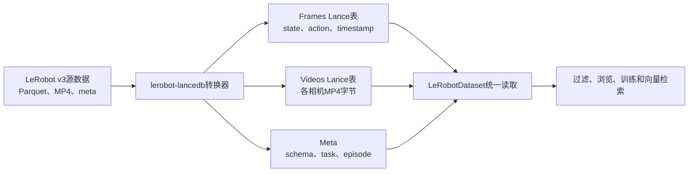

# LanceDB 与 LeRobot 数据管理实验

## 1. LanceDB 是什么

LanceDB 是面向人工智能和多模态数据的开源数据库，底层使用 Apache Arrow 生态的 Lance 列式格式。它可以在本地磁盘或对象存储上管理表格数据、向量和多媒体对象，并同时支持：

- 标量字段查询与过滤；
- 向量相似度检索；
- 全文检索；
- 数据版本与列式读取；
- 图片、视频、文本和模型特征的统一管理；
- PyTorch、Pandas和Arrow等数据工具。

LanceDB不等于“只保存embedding的向量数据库”。它更接近面向AI数据的多模态数据湖仓：既能保存状态、动作等结构化列，也能保存或引用视频，还能为文本、图像及轨迹embedding建立向量索引。

## 2. 为什么适合LeRobot数据

LeRobot数据通常包括：

```text
Episode
├── 多路相机视频
├── observation.state
├── action
├── timestamp和frame_index
└── task等元数据
```

标准LeRobot v3主要使用Parquet、MP4和元数据文件。LanceDB后端可把这些数据转换成可随机访问和索引的Lance表，同时保持LeRobot的数据读取接口。适合以下场景：

- 按episode、任务和机器人过滤训练数据；
- 只读取训练批次所需的行和视频字节；
- 给episode添加质检分数、标签和embedding；
- 查找视觉、文本或动作轨迹相似的episode；
- 直接从对象存储流式读取训练数据。

当前LeRobot的Lance后端以**读取和训练**为主。推荐先按标准Parquet/MP4格式完成采集和编辑，再生成Lance副本；源数据不要删除。

## 3. 本机发现的SO-101数据

本次只读扫描发现多份LeRobot数据，其中选择以下最大且已完成的数据集进行实验：

| 项目 | 值 |
|---|---|
| 源数据集 | `so101_pickplace_20s_20260726_194336` |
| 机器人类型 | `so_follower`（SO-101六维动作/状态） |
| LeRobot格式 | v3.0 |
| Episode数量 | 15 |
| 总帧数 | 11210 |
| 采样率 | 30 FPS |
| 源数据大小 | 约435 MB |
| 图像通道 | 包含腕部相机等视频特征 |

源目录位于用户的LeRobot缓存中。为了避免误删除或把个人目录写入脚本，实际路径记录在下方“转换记录”中；转换过程只读源数据，输出写入本工程。

另外还发现数份0～5个episode的调试数据。本实验不合并它们，避免空数据集和不同采集配置污染训练数据。

## 4. 数据转换流程



转换不会修改源数据：

```text
源LeRobot数据（保留）
        ↓ 读取和转换
LanceDB/data/so101_pickplace_lance（新建）
```

## 5. 环境与命令

本实验使用独立Python环境：

```bash
cd /home/wxf/exam1002/LanceDB
source .venv/bin/activate
```

本工程已经安装好相关组件。验证当前命令确实来自虚拟环境：

```bash
which python
which pip
python -m pip show lerobot-lancedb
```

正常情况下，前两个命令都应该指向：

```text
/home/wxf/exam1002/LanceDB/.venv/bin/
```

不要直接使用来源不明的 `pip`。如果以后重新创建虚拟环境，需要安装组件，应使用：

```bash
python -m pip install lerobot-lancedb 'lerobot[dataset]'
```

`python -m pip` 可以保证pip属于当前显示的那个Python环境，避免误用Conda或系统pip。

典型转换命令如下，具体参数以本机安装版本的`--help`为准：

```bash
lerobot-lance-convert \
  --root <LeRobot源数据目录> \
  --out ./data/so101_pickplace_lance
```

## 6. LanceDB与Qdrant的区别

| 对比项 | LanceDB | Qdrant |
|---|---|---|
| 定位 | AI多模态数据湖仓/数据库 | 专业向量检索服务 |
| 部署 | 可嵌入Python进程，也支持服务形态 | 通常作为独立服务运行 |
| 原始数据 | 可保存表格行和视频字节 | 通常保存向量及Payload |
| 标量查询 | 支持 | 主要用于Payload过滤 |
| 向量检索 | 支持 | 强项 |
| LeRobot集成 | 有专用转换和读取后端 | 需要自行抽取embedding和ID |
| 适合本实验 | 数据存储、筛选和训练读取 | 大规模独立语义/相似轨迹检索 |

## 7. 生产使用建议

实验阶段可以把Lance数据放在本地目录；正式平台建议：

```text
PostgreSQL：用户、权限、项目、数据集版本
MinIO/S3：原始LeRobot和Lance数据文件
LanceDB：训练读取、标量/全文/向量索引
FiftyOne或Rerun：episode浏览和质检
```

Lance副本属于派生数据。必须保留原始LeRobot数据、转换工具版本和校验清单，以便重建和追溯。

## 8. 转换记录

转换源：

```text
/home/wxf/.cache/huggingface/lerobot/local/so101_pickplace_20s_20260726_194336
```

转换目标：

```text
/home/wxf/exam1002/LanceDB/data/so101_pickplace_lance
```

实际转换结果：

| 项目 | 结果 |
|---|---:|
| 转换状态 | 成功 |
| `frames.lance` | 11210行 |
| `videos.lance` | 2行，即2个相机视频对象 |
| `meta.lance` | 4行，即4个元数据文件 |
| 转换后总容量 | 约228.2 MB |

转换后的目录包括：

```text
data/so101_pickplace_lance/
├── frames.lance/
├── videos.lance/
├── meta.lance/
└── meta/
```

运行只读检查程序：

```bash
cd /home/wxf/exam1002/LanceDB
source .venv/bin/activate
python inspect_lancedb.py
```

本次转换使用：

- Python 3.12.13
- LeRobot 0.6.1
- `lerobot-lancedb` 0.3.1
- LanceDB 0.40.0

源数据仍保留在原LeRobot缓存目录中，没有移动或删除。

## 9. 使用Web GUI浏览数据

本目录的`compose.yaml`使用Lance Data Viewer，并把转换后的数据以只读方式挂载到容器中。

启动：

```bash
cd /home/wxf/exam1002/LanceDB
docker compose up -d
docker compose ps
```

浏览器访问：

```text
http://localhost:8080
```

页面中可以看到三张表：

- `frames`：11210帧机器人数据，可预览`action`和`observation_state`两个6维数组。
- `videos`：两个相机视频对象及其索引信息。
- `meta`：LeRobot数据集元数据。

查看日志：

```bash
docker compose logs -f
```

停止但保留容器：

```bash
docker compose stop
```

停止并删除容器和Compose网络（不会删除本地Lance数据）：

```bash
docker compose down
```

`compose.yaml`中的`:ro`表示只读挂载，GUI不能修改原始数据。

## 10. 参考资料

- [LanceDB官方文档](https://docs.lancedb.com/)
- [LeRobot Dataset v3与LanceDB后端](https://github.com/huggingface/lerobot/blob/main/docs/source/lerobot-dataset-v3.mdx)
- [lerobot-lancedb开源转换工具](https://github.com/lancedb/lerobot-lancedb)

