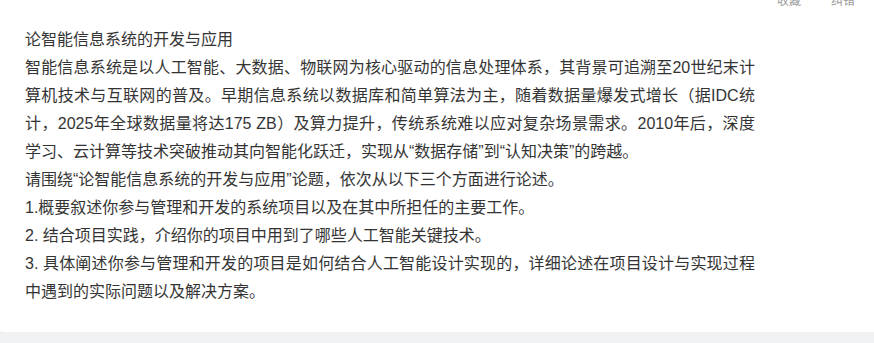
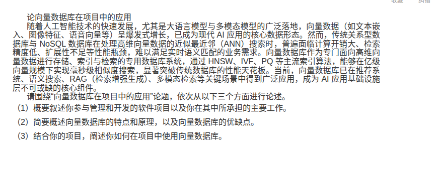
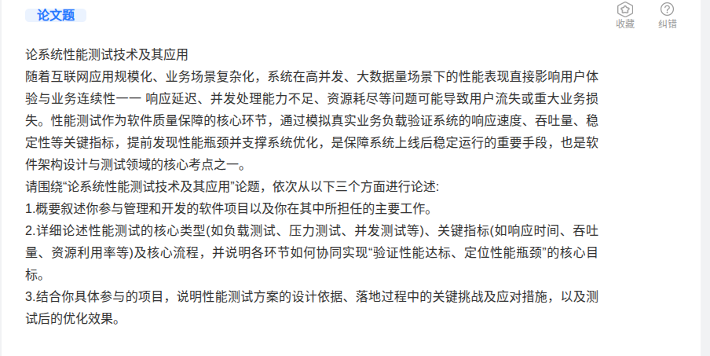
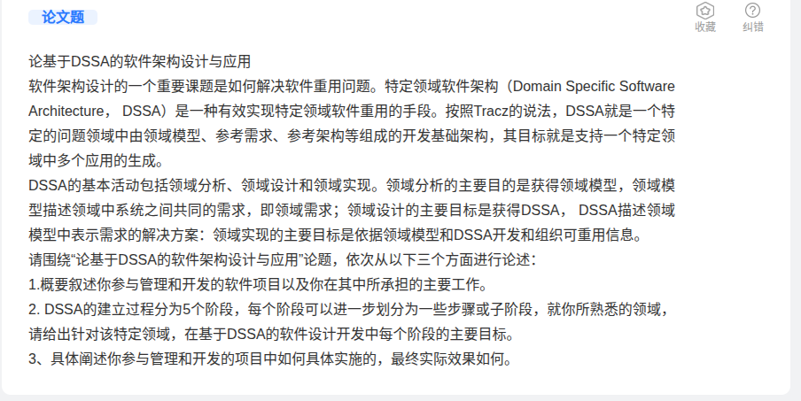

# 场景内容

敏实内部 POC 项目， 铝条弯曲上下料场景， 

1  整个项目 ，实施时做了对照， 分别用 传统轨迹自动化， 和  推理自动化， 

2 弯曲上下料， 有2台弯曲机， 2台上料传送带， 2台下料传送带

2.1 弯曲场景中， 分为两组， 第一组， 使用 g2人形机器人， 全部走传统方式， 用地图固定点位， 机器人轨迹运动， 结合二维码 APRITAG 做位置纠正

第二组， 也是g2机器人， 除了底盘运动是传统的地图导航运动， 铝条的上料传送带抓取， 弯曲机上放置， 弯曲机上加工完后抓取， 再把铝条放置到下料传送带 ， 这4个动作， 都是 VLA 推理

也就是说， 一组是传统， 一组是推理

3 产线推理机， 为4090 24G 显存的推理机， 128G内存， ubuntu 24.04 系统，  为远程wifi推理。  推理机在机房， G2机器人在产线上， 使用 ap无线接入。 推理频率为 10HZ 。 但是在g2机器上， 有个推理后接口层， 将频率又改为 30hz来执行， 

4 目前测试下来， 传统的那一组， 为  1分钟 的节拍， 但是推理的那一组， 需要 1分30秒。 

传统的方案中， 平均每个动作 15秒， 但是推理的时候， 发现推理命令启动时，需要 6-8秒的等待时间。 

5 模型的采集， 我们一般是分多轮采集， 第一轮是功能验证采集， 采集300条， 训练一个模型， 这个模型有可能推理失败， 然后我们尝试去调整参数， 比如 chunksize ， steps ， 机器参考模型类别， 32位 还是64位 还是更高位， gpu数量， 

我们使用 算力自由平台的 A100*2 的gpu服务器，内存 240G, 6块钱一小时， 按量租用。 对于 300条的数据， 我们用 GROOT1.7 基座来微调， 一般要2小时

第一轮采集后训练， 可能会训练3次， 最终得到一个可以正确推理的模型， 但是推理成功率 30% 以下

然后第二轮， 我们会补充采集 800到1000条， 都是动作正常的数据， 然后再训练， 这回步骤数会比之前多， 比如第一轮步 20000步， 第二轮就是 200000 步， 训练时间大概8小时， 这个模型的推理成功率会 60%

然后，我们会观察失败的情况， 总结失败的原因， 做  失败情况补偿采集  ， 每种失败场景采集 50条， 最后差不多 300 条左右的失败情况补充数据， 再训练一轮模型， 此时的成功率会提高到  90%

6 上面提到的 3轮采集， 以及后续的推理， G2机器人底盘是不动的。 
一旦我们把位移加上， 然后g2的底盘重复定位精度有4cm的误差， 就会大大降低推理的成功率， 
我们发现， 底盘移动之后， 推理成功率就会下降到50%， 

7 客户方面， 要求我们把节拍， 整体的控制在 30秒 以内， 我们做不到， 两边开会经常吵

8 目前， 我们在4台g2机器上存储了大量的 lerobot 格式的数据， 比较杂乱， 我们想用  pgsql  等数据库， 对这些数据作规范化管理。   

想使用  关系型， 对象型， 向量数据库  对这些做管理

# 论文1

# 论文2 

# 论文3 

# 论文4

# 目标要求

请根据我所描述的场景， 和4个论文题目， 生成 4篇论文， 

这是我做软考架构师考试的准备

论文中请加入一些图表