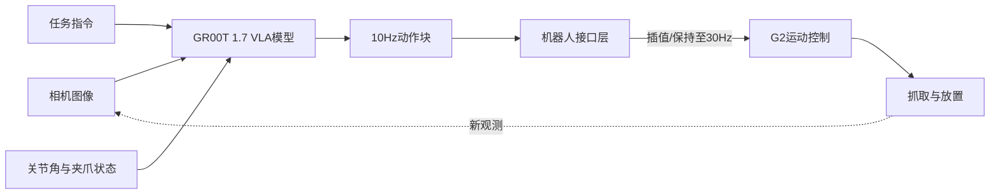
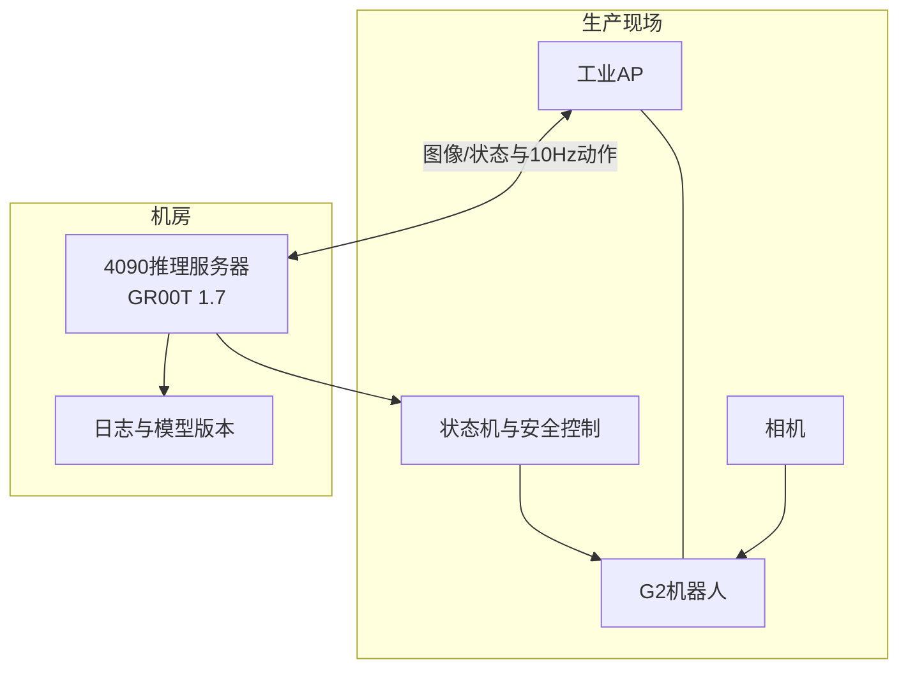

# 论智能信息系统的开发与应用

## 摘要

2026年，我所在企业为验证具身智能技术在汽车零部件生产中的应用价值，启动了铝条弯曲上下料POC项目。我作为部门经理和项目负责人，负责需求分析、总体架构设计、VLA技术路线选型、跨专业资源协调和关键问题决策。项目在两套相同的弯曲单元上开展对照：第一组采用地图导航、固定轨迹与AprilTag纠偏的传统自动化方案；第二组底盘仍采用传统导航，但上料带抓取、弯曲机放置、加工后取件和下料带放置四个关键动作由基于GR00T 1.7微调的VLA模型推理完成。推理服务部署在机房的RTX 4090服务器上，通过无线网络以10Hz产生动作，机器人接口层以30Hz执行。项目采用三轮递进式数据采集与训练，使固定底盘条件下的任务成功率由不足30%提高到约90%。针对底盘移动后4cm定位误差导致成功率降至约50%、推理启动等待6～8秒及客户30秒节拍目标暂未达到等问题，我们采用AprilTag视觉纠偏、失败场景补偿采集、动作分段、专用夹爪和工装容差设计持续改进。本文结合该项目，论述智能信息系统关键技术、架构设计、实施问题及解决方法。

## 一、项目概况及本人工作

该项目包含两台弯曲机、两条上料传送带和两条下料传送带，每个单元配置一台智元G2人形机器人。铝条从上料传送带到达后，机器人需要抓取并放入弯曲机；加工完成后再从弯曲机取出，放到下料传送带。为了客观比较新技术价值，我组织团队建立了传统组与推理组两条路线。

| 环节 | 传统组 | VLA推理组 |
|---|---|---|
| 底盘移动 | 地图导航＋固定点位 | 地图导航＋固定点位 |
| 位置纠偏 | AprilTag | AprilTag及视觉观测 |
| 四个上下料动作 | 固定轨迹 | GR00T 1.7推理 |
| 当前完整节拍 | 约60秒 | 约90秒 |
| 主要优势 | 快、确定性强 | 对位置和场景变化更有适应性 |

我负责组织工艺、机械、电气、机器人、网络和算法人员完成系统设计；制定传统方案与VLA方案的对照试验；组织示教数据采集、云端训练、现场推理和效果评价；审核机器人安全边界；协调客户对节拍目标和POC目标的认识；并针对成功率、定位误差和推理延迟主持专项改进。

## 二、项目采用的人工智能关键技术

VLA即视觉—语言—动作模型，其输入包括多路相机图像、自然语言任务和机器人本体状态，输出机器人动作序列。与传统固定轨迹不同，VLA不是简单复现一个绝对点位，而是根据当前观测生成动作，因此更适合工件位置存在变化的场景。

模型训练采用模仿学习思路。操作者通过遥操作完成正确示范，系统同步记录图像、关节状态、时间戳和动作，形成LeRobot格式episode。第一轮采集约300条，用于打通流程和验证功能，使用租用的双A100服务器进行微调，单次约2小时。团队围绕动作块长度、训练步数、模型规模和GPU配置进行多次试验，得到能完成动作但成功率低于30%的初版模型。

第二轮补充800～1000条正常数据，将训练步数由约2万步提高到约20万步，训练约8小时，成功率提高到约60%。第三轮不再盲目增加正常样本，而是分析夹偏、抓空、接近方向错误和放置偏移等失败模式，每类补采约50条，总计约300条，再次训练后，固定底盘条件下成功率提高到约90%。这体现了数据闭环技术：采集、训练、推理、失败分析、补偿采集和再训练持续迭代。

系统还采用了传统定位与智能推理融合的混合架构。底盘导航、工作空间限制、速度限制、急停和流程状态机仍由确定性程序负责；模型主要处理四个对环境变化敏感的操作动作。该设计既发挥VLA的泛化能力，又避免将人员安全和设备安全完全交给概率模型。

## 三、系统设计、问题与解决方案

推理服务器配置RTX 4090 24GB显存、128GB内存和Ubuntu 24.04，部署在机房；G2机器人位于产线，通过AP无线接入。服务器按照10Hz输出动作，机器人侧接口层以30Hz执行。为防止网络中断时机器人继续使用旧动作，我要求动作消息携带时间戳和序号，超过有效期即丢弃；接口层设置有界缓冲区、超时停止和速度限制，不允许历史动作无限排队。

第一个问题是模型在固定底盘时成功率较高，但底盘移动后成功率降至约50%。排查发现G2底盘重复定位误差约4cm，训练数据主要覆盖固定站位，摄像机视角和机械臂相对工件的位置分布发生了变化。为此，我们保留地图导航，并在工位增加AprilTag进行视觉纠偏；同时采集包含位置扰动的数据，在工装上增加导向结构和容差区，把一次精确放置拆分为粗定位与二次精定位。该问题说明模型泛化不能替代定位基准和机械容差。

第二个问题是推理组节拍约90秒，而传统组约60秒，客户希望压缩至30秒。链路分析发现，每个推理动作启动前存在6～8秒等待，来源包括观测组装、远程传输、模型上下文初始化和动作块生成。我们采取模型常驻与预热、提前采集下一阶段观测、减少不必要的同步日志、压缩图像、复用推理上下文以及在安全前提下合并连续状态等措施。由于POC阶段尚未达到30秒，我在评审中明确区分“技术可行性”和“生产节拍达标”，没有把90%成功率等同于已经具备量产条件。

第三个问题是长铝条使用通用夹爪时，抓取点稍有偏差便会旋转或滑移。团队最初希望完全依靠模型修正，但这会显著增加数据量和推理难度。我决定改用适配铝条截面的专用夹爪，并调整弯曲机入口工装，使机械结构能够被动纠偏。最终形成“模型处理变化、机械结构扩大容差、确定性程序保障安全”的系统分工。

## 四、实施效果与总结

项目完成了传统自动化与VLA推理自动化的同场对照，打通了从LeRobot数据采集、云端微调、模型部署到真机执行的闭环。三轮训练使固定底盘条件下成功率从不足30%提升到约90%，团队也掌握了失败驱动的数据补偿方法。与此同时，对照结果清楚表明：当前VLA方案在节拍、移动后稳定性和网络依赖方面仍弱于传统方案，尚需继续优化。

通过本项目我认识到，智能信息系统建设不能只追求模型先进性。工业现场需要把人工智能、确定性控制、机械工装、网络通信、数据治理和安全机制作为一个整体设计。对于固定、规则且追求极限节拍的动作，传统轨迹仍有优势；对于位置变化和柔性任务，VLA提供了新的可能。架构师的职责不是在两者之间简单选边，而是依据质量属性进行合理分工，并用可量化的对照试验推动技术从POC走向可生产应用。

