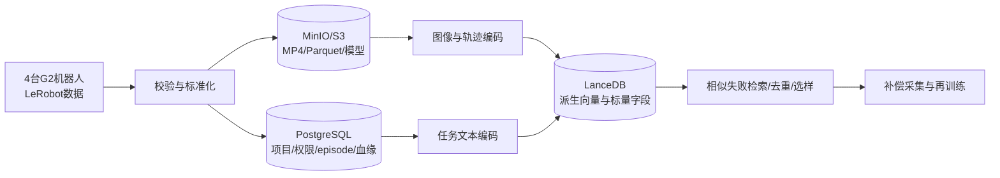

# 论向量数据库在项目中的应用

## 摘要

2026年，我所在企业开展智元G2机器人铝条弯曲上下料POC。项目在四台机器人上分多轮采集了大量LeRobot格式数据，包括多路视频、关节状态、动作、任务和episode元数据，但文件散落在各机器人控制器中，存在命名不统一、重复样本多、失败案例难检索和训练数据不可追溯等问题。我作为部门经理和项目负责人，主持设计统一的VLA数据管理平台：以PostgreSQL管理用户、权限、项目和数据目录，以对象存储保存MP4、Parquet、模型文件和原始数据，以LanceDB保存图像、文本和轨迹的派生向量，并通过全局ID关联原始episode。平台采用视觉编码器、文本Embedding模型和轨迹编码方法生成向量，使用近似最近邻索引完成相似画面、相似失败轨迹和自然语言任务检索。本文结合项目，说明向量数据库的原理、特点和优缺点，并重点论述其在失败场景补采、数据去重、训练集构建和模型追溯中的应用。

## 一、项目概况及本人主要工作

项目包含两组铝条弯曲单元，一组采用固定轨迹，另一组采用GR00T 1.7进行VLA推理。VLA组分别对上料带抓取、弯曲机放置、加工后取件和下料带放置四个动作采集示范。第一轮约300条用于功能验证，第二轮补充800～1000条正常示范，第三轮针对不同失败类型补充约300条。数据量不断增长后，依靠文件夹已难以回答“哪些数据训练了哪个模型”“某个失败画面是否出现过”“哪些episode高度重复”等问题。

我负责组织数据现状盘点、质量属性分析和总体架构设计；确定原始数据不可修改、派生向量可重建的原则；设计业务库、对象存储和向量数据库的职责边界；制定episode、模型、向量和标注的关联方式；并组织建立从推理失败回流到相似数据检索、补偿采集和再训练的闭环。

## 二、向量数据库的特点、原理和优缺点

向量数据库面向高维向量的存储、索引与相似度检索。图像、文本和机器人轨迹经过Embedding模型后，会变成固定维度的浮点数组。查询时，系统根据余弦相似度、欧氏距离或内积衡量向量相似程度，再使用ANN近似最近邻算法避免逐条扫描全部数据。

HNSW将相似向量组织成分层小世界图，上层用于快速跳转、底层用于精细查找，特点是查询快、召回率高，但索引占用内存较多。IVF先把向量聚类到多个倒排分区，查询时只搜索最接近的若干分区；PQ则把高维向量分段量化，用较短编码替代原始浮点数，从而减少空间和距离计算成本。实际选型需在召回率、延迟、索引大小和构建时间之间权衡。

| 对比项 | 关系数据库 | 对象存储 | 向量数据库 |
|---|---|---|---|
| 典型数据 | 用户、权限、项目、episode目录 | MP4、Parquet、图片、模型 | 图像/文本/轨迹Embedding |
| 擅长查询 | 精确条件与事务 | 按对象键读取大文件 | 相似度、语义和近邻检索 |
| 本项目产品 | PostgreSQL | MinIO/S3 | LanceDB |
| 是否保存权威原始数据 | 保存业务元数据 | 是 | 否，保存可重建派生数据 |

向量数据库的优点是能突破关键词完全匹配限制，支持图搜图、语义搜索、相似轨迹检索，并可结合任务类型、机器人型号、成功标记等标量条件过滤。缺点是近似检索存在召回损失，索引需要额外存储和构建时间，Embedding质量直接决定检索效果，模型升级还可能造成新旧向量空间不兼容。因此它不能替代关系数据库和对象存储，而应作为多模态数据平台的检索层。

## 三、向量数据库在项目中的设计与应用

我将数据分为原始层、标准层和检索层。原始层完整保存机器人控制器上的源目录；标准层把关节角和动作整理为Parquet，把视频整理为MP4，并建立统一episode元数据；检索层抽取关键帧、任务描述和动作窗口，生成向量写入LanceDB。

向量记录至少包含`vector_id`、`episode_id`、`frame_start`、`frame_end`、`task`、`success`、`robot_id`、`encoder_version`和向量字段。原始视频不重复塞入向量索引，LanceDB只保存对象地址和必要预览信息。这样，任何搜索结果都能返回对应视频、关节轨迹、采集批次和训练模型。

第一项应用是失败案例检索。现场出现夹偏或放置偏移后，系统对故障前后若干秒的关键帧及轨迹生成查询向量，在`task=铝条上料`且`success=false`范围内寻找最相似episode。工程人员可以快速判断这是已知失败模式还是新问题，并按失败类别安排每类约50条的补偿采集。相比人工遍历文件夹，该方法更适合项目的第三轮数据闭环。

第二项应用是训练数据去重和多样性选择。连续遥操作数据中存在大量静止帧和高度相似动作，如果全部进入训练集，会增加训练时间并造成样本分布失衡。平台通过向量聚类或相似度阈值识别重复片段，再结合任务阶段和成功标记保留代表样本。删除只是针对Gold训练清单，原始对象仍保留，保证可追溯。

第三项应用是跨模态检索。工程师输入“底盘移动后从上料带抓空”等自然语言，文本Embedding可检索相似任务描述和视觉片段；上传一张机器人夹爪接近铝条的图片，可以找到相似姿态的历史关键帧。这为数据质检、问题复盘和训练集构建提供了统一入口。

第四项应用是位置扰动数据筛选。固定底盘模型成功率可达到约90%，但底盘移动并引入约4cm误差后降至约50%。我们可用位姿和视觉向量寻找训练集中覆盖不足的区域，按距离、方向和工位分桶，指导采集人员补齐边缘分布，而不是继续重复采集中心位置的正常数据。

项目实施中主要遇到三个问题。首先，直接把单帧关节角当语义向量会导致“数值接近但动作阶段不同”。我们改为按时间窗口编码轨迹，并附加任务阶段过滤。其次，不同编码模型产生的向量不能直接比较，因此将`encoder_name`和`encoder_version`作为强制字段，模型升级时建立新向量列或新表。最后，ANN只能返回“数学上相似”，不保证业务上正确，因此搜索结果还要结合任务、机器人、成功状态和工位等条件过滤，并由工程人员确认。

## 四、项目效果与总结

该方案把分散在四台G2机器人上的LeRobot数据转化为可查询、可追溯和可持续扩展的数据资产。PostgreSQL保证业务管理和权限，MinIO/S3保存权威原始数据，LanceDB支持相似失败、语义任务和轨迹检索。数据闭环由过去的人工翻目录，转变为“失败片段入库—相似检索—原因归类—定向补采—再训练—效果回写”。

我认为，向量数据库在VLA项目中的价值不在于简单保存关节数组，而在于把非结构化视频、文本和轨迹映射到可比较的特征空间，帮助团队找到相似经验并改进数据分布。同时必须认识到，向量是派生索引而不是原始事实。只有把向量检索与关系元数据、对象存储、版本管理和人工质检结合，才能形成可靠的机器人数据基础设施。

