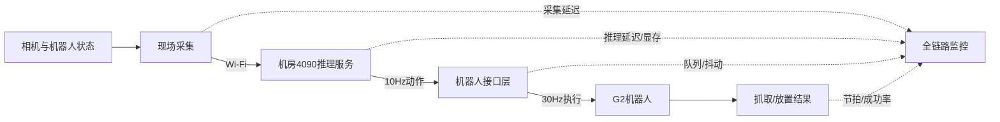

# 论系统性能测试技术及其应用

## 摘要

2026年，我作为部门经理和项目负责人，主持了工厂铝条弯曲上下料POC项目。项目采用两套相同生产单元进行对照：传统组使用地图导航、固定轨迹和AprilTag纠偏，完整节拍约60秒；推理组使用GR00T 1.7完成四个关键抓放动作，完整节拍约90秒，而客户要求控制在30秒以内。VLA推理服务器为RTX 4090 24GB显存、128GB内存、Ubuntu 24.04，通过无线网络远程服务产线机器人，以10Hz产生动作，由机器人接口层按30Hz执行。为客观验证系统性能并定位瓶颈，我组织开展负载、压力、并发、容量和稳定性测试，建立采集、网络、预处理、推理、动作接口和机械执行的全链路观测。测试发现每个推理动作启动存在6～8秒等待，底盘约4cm重复定位误差会使成功率由固定站位约90%降至约50%。我们通过模型常驻预热、有界队列、观测流水线、异步日志、AprilTag纠偏、扰动数据补采和工装容差改造进行优化。本文结合该项目，论述性能测试类型、指标、流程、挑战及改进效果。

## 一、项目概况及本人工作

项目含两台弯曲机、两条上料带、两条下料带及两台G2机器人。传统组四个动作平均约15秒，整体约60秒；VLA组在上料抓取、弯曲机放料、加工后取料和下料放置时调用远程模型，整体约90秒。我负责制定对照试验、性能目标和测试策略；组织算法、机器人、网络、工艺与机械人员建立监控链路；主持瓶颈分析；并协调客户对30秒目标、当前POC能力和后续优化范围达成分阶段认识。

## 二、核心类型、指标和流程

负载测试验证系统在设计负载下能否稳定达到目标；压力测试逐步增加输入频率和并发，寻找性能拐点及失效方式；并发测试模拟多个机器人会话同时访问GPU，观察资源竞争与公平性；容量测试扩大episode、视频、日志和模型数量，验证数据规模增长后的处理能力；稳定性测试让系统长时间运行，发现内存泄漏、显存碎片和延迟漂移。

| 测试类型 | 本项目测试方式 | 关注指标 |
|---|---|---|
| 负载 | 按真实10Hz输入回放观测 | P95/P99延迟、动作节拍 |
| 压力 | 提升帧率、分辨率和请求数 | 性能拐点、超时率、恢复能力 |
| 并发 | 多逻辑机器人共享推理服务 | 吞吐、排队、显存与公平性 |
| 容量 | 扩大episode和视频规模 | 扫描、抽样、索引和存储速度 |
| 稳定性 | 长时间循环任务与模型切换 | 资源泄漏、延迟漂移、成功率 |

指标分为四类：时间指标包括图像采集、网络、预处理、模型推理、动作转换和端到端延迟；吞吐指标包括每秒推理次数与单位时间完成任务数；资源指标包括CPU、内存、GPU利用率、显存、带宽和磁盘；业务指标包括完整节拍、抓取与放置成功率、过期动作率及安全停止次数。对机器人系统而言，提高GPU吞吐但降低动作成功率并不构成真正优化。

测试流程为：建立性能模型，分解端到端预算，固定软硬件与模型版本，准备正常、边界和失败数据，执行基准与各类测试，关联日志定位瓶颈，实施优化后以相同基线复测。真机压力测试可能造成碰撞，因此高负载首先通过历史episode回放完成，之后才进行受限速度、受限工作空间和有人监护的硬件在环测试。

## 三、方案实施、关键挑战及应对

首先，我要求为每个观测和动作附加任务ID、episode、帧号、单调时钟时间戳和模型版本，在采集、发送、接收、预处理、推理开始、推理结束、动作下发等位置埋点。分析时同时查看平均值、P95、P99与最大值，因为少量6～8秒的长尾会使机器人明显停顿，而平均值可能掩盖这一问题。

针对推理启动等待，我们将总延迟拆解后发现模型调用前后存在多处串行等待。团队采用模型常驻和启动预热，避免每个动作重复初始化；将采集、图像预处理、推理和日志改为有界流水线；只保留最新有效观测，过期帧直接丢弃；日志异步批量写入；并提前准备下一状态所需观测。10Hz模型输出到30Hz控制接口之间不使用无限队列，而采用动作保持、受限插值和超时停止，避免积压后执行过期命令。

针对无线网络，我组织测试不同信号强度下的往返延迟、抖动、丢包和短时断联。接口层设置动作有效期与序号校验，网络超时后机器人进入保持或安全停止；视觉数据采用适度压缩并控制发送频率。这样即使Wi-Fi波动，也不会把网络缓存中的旧动作继续送给机器人。

针对共享GPU并发问题，我们用多个逻辑机器人会话阶梯加压，观察批量大小、显存和长尾延迟。大批量虽能提高吞吐，却增加闭环等待，不适合实时动作。因此系统限制最大批量和排队时间，在线控制请求优先于离线评估任务，达到容量阈值时拒绝新任务而非让进程因显存耗尽退出。

测试还发现，软件延迟达标并不代表业务成功。模型在固定底盘条件下经过三轮训练可达到约90%成功率，但底盘移动带来的约4cm误差使成功率降到约50%。这不是单纯增加GPU即可解决的问题。我们增加AprilTag工位纠偏，补采不同偏移量的数据，并通过专用夹爪、工装导向、粗定位和二次精定位扩大机械容差。

| 测试发现 | 根因 | 应对措施 | 结果方向 |
|---|---|---|---|
| 推理动作启动等待6～8秒 | 初始化及多环节串行 | 常驻预热、流水线、异步日志 | 降低启动和长尾等待 |
| 10Hz到30Hz存在动作过期风险 | 网络与接口队列积压 | 有效期、序号、有界缓冲和超时停止 | 提高控制安全性 |
| 并发时显存和延迟上升 | GPU资源竞争 | 限批、限流、请求分级 | 明确安全容量 |
| 移动后成功率约50% | 4cm定位误差及分布偏移 | AprilTag、扰动补采、工装纠偏 | 改善移动后的鲁棒性 |

## 四、优化效果与总结

测试使团队明确了90秒节拍的组成和系统安全容量，验证了超载、断网及过期动作情况下的保护机制。模型预热、流水线与异步日志减少了软件等待；视觉纠偏和机械容差改造提高了移动后的稳定性。但当前方案仍未达到客户30秒的目标，因此我将结果定义为“智能动作可行性得到验证，生产节拍尚未达标”，并制定模型推理、网络部署、动作合并和工艺并行的后续计划。

本项目说明，性能测试的目标不是得到一个漂亮的平均值，而是验证业务指标、定位性能瓶颈并指导架构权衡。工业VLA系统的性能取决于模型、GPU、网络、控制接口、机器人和工装的共同作用。只有把P95/P99延迟、吞吐、资源利用率与成功率、节拍、安全状态结合起来，才能判断系统是否真正具备上线条件。

