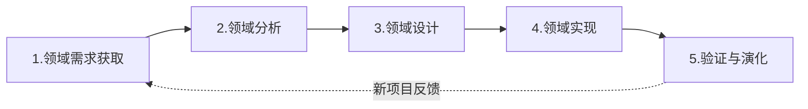
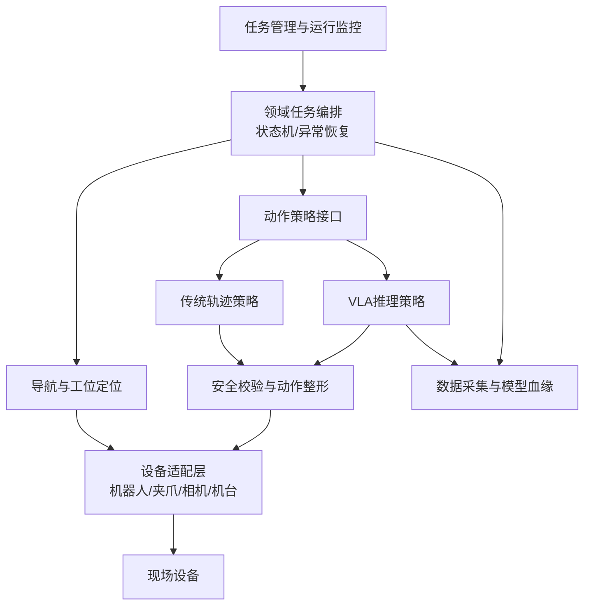

# 论基于DSSA的软件架构设计与应用

## 摘要

2026年，我所在企业计划将人形机器人逐步应用于多个工厂的上下料、搬运和机台操作场景。首个POC以铝条弯曲上下料为对象，包含传统轨迹自动化与VLA推理自动化两种实现。随着机器人、工位、工件和模型增加，如果每个项目都重新开发导航、采集、推理、控制和数据管理软件，将造成重复建设和维护困难。我作为部门经理和项目负责人，引入特定领域软件架构DSSA方法，围绕“工业人形机器人上下料”领域开展领域分析、领域设计和领域实现。我们识别了任务编排、安全控制、设备适配、数据采集、模型服务和运行监控等共性，提取工件、机器人、定位方式、传统轨迹与VLA策略等可变点，形成分层架构、领域模型、参考流程和可复用组件。首个铝条项目完成了两台弯曲机、两条上下料带和两台G2机器人的验证，并为后续复制到其他工位建立了软件资产。本文结合该项目，论述DSSA建立过程、领域活动和应用效果。

## 一、项目概况及本人主要工作

项目要求G2机器人完成上料带取件、弯曲机放料、加工后取件和下料带放置。传统组采用地图固定点位、轨迹控制和AprilTag纠偏；推理组的底盘仍走传统导航，四个操作动作由GR00T 1.7模型推理。推理服务器位于机房，使用RTX 4090、128GB内存和Ubuntu 24.04，通过无线网络与产线机器人通信。

我在项目中负责识别企业未来机器人应用的共性需求，确定DSSA范围；组织工艺、机器人、算法、数据和软件人员开展领域分析；主持参考架构及可变点设计；决定把具体设备SDK、模型实现和工艺参数封装在适配层；并推动首个POC作为领域架构的验证项目，而不是仅完成一次性交付。

## 二、DSSA建立过程与五阶段说明

DSSA是面向一类特定业务领域的可复用软件架构。按照领域工程思想，其核心活动可概括为领域需求获取、领域分析、领域设计、领域实现和领域验证/演化五个阶段。

第一阶段是领域需求获取。团队调研铝条弯曲、搬运、机台上下料等候选场景，收集机器人型号、工件、节拍、安全、网络和数据要求，确定领域边界为“工厂内人形机器人的离散型上下料任务”，不涵盖机器人底层伺服控制和工厂ERP内部实现。

第二阶段是领域分析。我们建立领域词汇和特征模型，识别所有应用共有的导航、工位定位、任务状态机、安全约束、动作执行、数据采集、日志和监控能力；同时识别机器人型号、工件、夹爪、工位、定位方式、动作策略和模型版本等差异。该阶段产出领域模型、共性/可变性清单和质量属性场景。

第三阶段是领域设计。根据模型设计参考架构、接口规范和配置机制，明确组件职责和依赖方向。架构使用设备适配、能力服务、任务编排、智能推理、数据治理及运维监控等层次；通过策略模式在传统轨迹和VLA推理之间切换，通过适配器屏蔽机器人和夹爪SDK差异，通过配置描述工位点位、AprilTag和安全区域。

第四阶段是领域实现。团队将地图导航、AprilTag定位、G2适配器、动作安全校验、任务状态机、LeRobot采集、模型客户端和日志追踪实现为可复用组件，并提供上下料流程模板。项目特定部分只需实现铝条夹爪参数、弯曲机握手协议和四个动作策略。

第五阶段是领域验证和演化。我们用传统组和VLA组验证参考架构，检查组件能否替换、质量属性是否达到要求，并把实际问题反馈到领域资产。例如，远程推理的10Hz输出到机器人30Hz执行暴露出动作时效需求，于是领域接口新增时间戳、序号、有界缓存和超时策略；底盘4cm误差则促使定位组件支持AprilTag二次纠偏。

## 三、DSSA在项目中的具体实施

领域分析的核心不是罗列功能，而是区分共性和可变性。我们的特征模型如下。

| 类别 | 共性特征 | 可变特征 |
|---|---|---|
| 设备 | 机器人、相机、夹爪、工位 | G2或其他机器人、不同夹爪和相机 |
| 定位 | 地图导航、工位坐标、安全区域 | AprilTag、视觉定位或固定标定 |
| 动作 | 接近、抓取、搬运、放置 | 固定轨迹、VLA推理或混合策略 |
| 数据 | episode、视频、状态、动作、模型版本 | 数据格式、相机数量、采样频率 |
| 运维 | 日志、监控、超时、急停 | 本地推理或远程推理、GPU型号 |

基于上述分析，我设计了如下参考架构：

在动作策略接口中，输入统一为任务上下文、当前观测和安全约束，输出统一为带时间戳的动作块。传统策略从轨迹库读取确定性动作；VLA策略通过远程客户端请求GR00T 1.7。上层任务编排不关心动作来自哪种方式，因此同一流程可以按工位配置选择传统、VLA或混合模式。这一设计直接支持了本项目的两组对照。

数据采集也是领域公共能力。组件统一记录episode、图像、机器人状态、动作、任务阶段、成功标记和模型版本，并输出LeRobot格式。首轮300条数据用于流程验证，第二轮800～1000条正常数据用于提高成功率，第三轮约300条失败补偿数据用于增强边缘场景。训练平台、步数和模型规模属于可变参数，不写死在任务程序中。

实施中出现了三个关键挑战。第一，客户30秒节拍与VLA组约90秒现状冲突。我们把节拍定义为领域质量属性，拆分导航、工艺等待、模型启动和动作执行预算，允许不同策略提供各自性能画像，防止用统一接口掩盖性能差异。第二，远程Wi-Fi推理存在延迟和断联风险。领域通信协议增加消息有效期、序号、重试边界和安全停止，现场接口只执行有效动作。第三，底盘移动导致约4cm误差，模型成功率从约90%降到约50%。我们将“工位精定位”提升为领域公共服务，而非在每个动作中临时修补，并组合AprilTag、扰动数据和机械导向解决。

## 四、应用效果与总结

通过DSSA方法，项目不仅实现了铝条弯曲上下料，还沉淀了任务编排、导航定位、动作策略、安全校验、设备适配、数据采集和监控等可复用资产。传统轨迹和VLA推理可以在相同业务流程下替换和对照；新增机器人或工位时，主要工作集中在设备适配器、工艺配置和少量专用动作，而无需重新开发整套系统。

项目也表明，DSSA前期需要投入领域建模和接口设计成本，如果领域范围过宽，容易形成抽象但不可用的“大平台”；如果范围过窄，又会退化为单项目架构。因此，我将范围限定在离散上下料，并通过真实POC不断验证和修正领域资产。

综上，DSSA的核心价值是从多个相似应用中提取稳定共性、显式管理差异，并通过参考架构和可复用组件降低后续项目成本。作为架构负责人，我不仅关注首个项目能否运行，也关注其知识能否转化为企业可持续复用的软件资产，这正是DSSA在工业机器人领域的实际意义。

