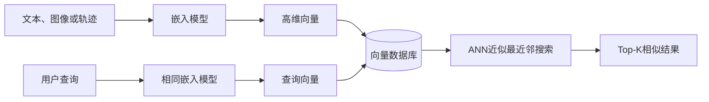
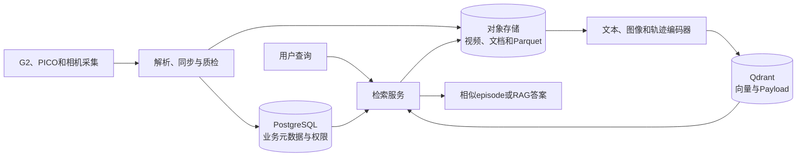

# 论向量数据库在项目中的应用

## 摘要

2026年，我所在企业为推动具身智能技术在工业场景落地，启动了G2机器人VLA数据管理与智能检索平台项目。项目通过PICO手柄遥操作机器人完成铝条抓取与放置，持续产生任务指令、实验报告、多路视频、关键帧、关节角、末端位姿和控制动作等多模态数据。随着数据规模增长，传统文件目录和关系数据库只能按照名称、编号等精确条件查询，无法满足“查找与夹爪打滑相似的失败案例”“寻找动作轨迹相近的episode”等语义检索需求。

我作为部门经理兼系统架构负责人，负责需求分析、总体架构设计、向量数据库选型、数据模型和关键问题处理。项目采用PostgreSQL、对象存储、Parquet和Qdrant组成混合数据架构，通过嵌入模型将任务文本、图像关键帧和动作轨迹转换为固定维度向量，并利用HNSW索引完成近似最近邻检索。针对跨模态数据组织、轨迹长度不一致、访问权限和检索准确性等问题，我们分别采用统一episode标识、轨迹切片与归一化、Payload过滤、混合检索和二次重排序等方案。项目实现了机器人数据的语义检索、相似轨迹发现和RAG知识问答。本文结合该项目，论述向量数据库的特点、原理、优点及其具体应用。

## 一、项目概况及本人承担的主要工作

公司在2026年开展智元G2机器人铝条上下料POC项目，先后验证了π0.5、GR00T N1.7和LingBot-VLA 2.0等模型。为了训练和改进VLA模型，团队使用PICO手柄遥操作机器人完成抓取、搬运和放置任务。每条episode都包含自然语言任务、多路相机视频、机器人关节角、末端位姿、夹爪状态、控制动作及成功失败标签。

项目初期，这些数据直接保存在机器人控制器中。工程师可以根据文件名和采集日期查找数据，但无法有效处理语义相似而用词不同的内容。例如，“夹爪打滑”“工件抓取后旋转”和“铝条夹持不稳定”可能描述同类问题，传统关键词检索容易漏查；关节角和末端位姿则是长短不同的时间序列，也不能通过普通SQL直接判断两段动作是否相似。此外，实验报告、故障说明和设备手册分散存放，算法人员难以快速找到可用于问题分析的历史资料。

公司因此决定在统一VLA数据平台中增加向量检索能力。平台目标包括：按照自然语言查找相关实验和故障案例；根据图像寻找场景相似的关键帧；根据动作轨迹寻找相似episode；为RAG问答提供内部技术资料；同时保证查询结果受项目权限约束，并能追溯到原始数据。

我作为部门经理兼系统架构负责人，主要承担五项工作：一是组织算法、机器人、软件和运维人员分析业务场景及质量要求；二是确定关系数据库、对象存储和向量数据库的职责边界；三是对向量维度、距离度量、索引算法和Payload结构进行选型；四是主持文本、图像和轨迹向量化流程设计；五是针对检索不准、数据更新、权限隔离和索引一致性等问题组织测试与改进。

## 二、向量数据库的特点、原理及优点

向量是由一组数值构成的高维数组。文本、图像、语音和动作轨迹经过嵌入模型处理后，可表示为固定维度向量。嵌入模型会尽量使语义或特征相近的对象在向量空间中距离更近。例如“机械臂夹持失败”和“夹爪抓取不稳”虽然文字不同，但其文本向量通常具有较高相似度。

向量数据库是面向高维向量进行存储、索引和检索的数据库。查询时，系统先使用与入库阶段相同的嵌入模型把查询对象转换为向量，再计算查询向量与库中向量的距离，返回最接近的Top-K条记录。常见距离度量包括余弦相似度、欧氏距离和点积。

如果数据库逐一比较所有向量，能够得到精确结果，但数据量增大后查询成本很高。因此向量数据库通常采用近似最近邻算法。HNSW把向量组织成多层邻接图，查询时从稀疏上层逐步进入稠密下层，减少需要比较的向量数量，具有较高的查询速度和召回率，但会占用较多内存。IVF先把向量划分到多个聚类单元，查询时只搜索最相关的若干单元；PQ则通过乘积量化压缩向量，降低存储和计算开销，但会损失一定精度。

向量数据库除了向量，一般还保存Payload。例如一条关键帧向量可以携带episode编号、项目、机器人型号、任务、帧号和质量状态。检索时可以先限定“G2机器人、铝条任务、已通过质检”，再执行向量相似度搜索，从而把结构化过滤与语义检索结合起来。

| 对比项 | 关系数据库 | 向量数据库 |
|---|---|---|
| 核心数据 | 表、行和字段 | 高维向量及Payload |
| 典型查询 | 精确、范围和关联查询 | 相似度和Top-K近邻查询 |
| 常见索引 | B+树、哈希索引 | HNSW、IVF、PQ |
| 适用场景 | 用户、订单、权限和事务 | 语义搜索、图像检索、RAG和推荐 |
| 查询示例 | `episode_id=1001` | 查找与失败轨迹最相似的episode |

向量数据库的优点主要有四点。第一，它突破了传统数据库依靠精确字段匹配的限制，可以按照语义和特征检索文本、图像、语音等非结构化数据。第二，ANN索引能够在大规模高维数据中实现毫秒级相似度检索。第三，向量检索与Payload过滤结合后，可同时满足语义搜索和业务条件约束。第四，它可以作为RAG系统的检索基础，为大语言模型提供与问题相关的企业资料，降低仅依靠模型内部知识产生错误回答的风险。

向量数据库也存在局限。其检索质量依赖嵌入模型、数据清洗和切分方法；ANN以少量精度损失换取查询性能；向量索引需要额外存储和内存；相似度高不代表业务事实正确。此外，向量数据库不擅长复杂事务和多表关联。因此本项目没有用Qdrant替代PostgreSQL和对象存储，而是让三者分别承担擅长的职责。

## 三、向量数据库在项目中的具体应用

### 1. 总体架构与数据分工

项目采用混合存储架构。PostgreSQL保存用户、用户组、项目、机器人、任务、episode目录和权限；对象存储保存MP4视频、关键帧、实验报告和Parquet轨迹；Qdrant保存从文本、图像和轨迹中产生的向量及检索字段。三类数据通过全局episode ID关联。

我要求对象存储和Parquet作为原始事实的权威副本，Qdrant只保存可重新生成的派生索引。这样即使更换嵌入模型或重建向量集合，也不会破坏原始数据。向量记录的Payload包含项目、episode、机器人型号、任务、起止帧、质量状态和数据版本，便于过滤和回溯。

### 2. 三类向量索引

项目建立了三类Collection。第一类是文本向量，将任务指令、实验结论、失败原因和设备手册分块后进行向量化，用于自然语言检索和RAG。第二类是关键帧图像向量，用于查找物体摆放、夹爪姿态和环境布局相似的场景。第三类是轨迹向量，用于查找与当前动作过程相似的历史episode。

| Collection | 向量来源 | 典型用途 |
|---|---|---|
| `episode_text` | 任务描述、实验记录和故障说明 | 语义检索和RAG问答 |
| `keyframe_visual` | 抓取、搬运和放置关键帧 | 相似场景及异常姿态检索 |
| `trajectory` | 关节角、末端位姿和夹爪状态 | 相似动作与失败轨迹分析 |

轨迹数据不能把每帧关节角直接写入向量库。不同episode长度不同，速度和起止时刻也不一致，简单计算欧氏距离会产生误判。为此，我组织团队先按照接近、抓取、搬运和放置等动作阶段切片，再统一坐标系、重采样和归一化，最后由轨迹编码器生成固定维度向量。查询时由Qdrant召回候选轨迹，再使用动态时间规整和业务规则进行二次排序。

### 3. 检索流程和RAG应用

用户输入“查找夹爪抓住铝条后发生旋转的案例”时，系统先验证用户身份，并从PostgreSQL取得其可访问项目。查询文本经嵌入模型生成向量，Qdrant在满足项目、机器人型号和质量状态过滤条件的范围内执行HNSW检索。检索服务取得Top-K结果后，根据关键词命中、向量得分、数据版本和时间进行重排序，再返回对应视频片段、轨迹曲线和实验结论。

在RAG场景中，系统把相关文档片段连同文档名称、版本和episode编号交给大语言模型，并要求模型只依据检索材料回答。若最高相似度低于阈值，系统返回“未找到可靠依据”，而不允许模型自由编造。对于机器人安全参数、关节限位和控制指令等高风险内容，系统只展示原始资料并要求人工确认。

### 4. 主要问题及解决方案

项目首先遇到专业术语检索不准的问题。报警码、函数名和模型版本具有精确字符含义，纯向量检索可能把相似语义排在前面，却漏掉完全匹配的编号。对此，我采用关键词倒排检索和向量检索融合的方式，并建立“末端执行器—夹爪”等领域同义词，通过人工标注的查询集评估Top-K召回率。

第二个问题是数据和向量索引可能不一致。文档或episode更新后，如果旧向量仍然存在，用户会得到过期结果。我们为每个源对象计算内容摘要，并在向量Payload中记录数据版本和嵌入模型版本。更新时先在新Collection中生成索引，验证完成后切换别名；出现问题时可以快速回滚到旧版本。

第三个问题是权限泄露。向量本身虽然不容易直接阅读，但检索结果和Payload仍可能暴露项目内容。因此，权限过滤必须在向量召回阶段执行，检索结果返回前还要由PostgreSQL进行二次授权校验，对象文件只能通过短期签名地址访问。

第四个问题是相似结果不一定正确。我们没有只关注查询速度，而是建立包含正常、失败和易混淆样本的评测集，持续记录召回率、前K项准确率和查询延迟。系统对低分结果设置阈值，并保留工程师的相关或不相关反馈，用于改进切分策略、嵌入模型和重排序规则。

主要架构决策和权衡如下：

| 架构决策 | 获得的收益 | 付出的代价 |
|---|---|---|
| 采用HNSW近似搜索 | 查询速度快、召回率较高 | 增加内存和索引构建时间 |
| 混合检索与重排序 | 兼顾精确术语和语义相关性 | 查询链路更加复杂 |
| 原始数据与向量索引分离 | 可更换模型、重建索引、保证原始精度 | 需要维护多种存储的一致性 |
| 版本化Collection和别名切换 | 更新过程可验证、可回滚 | 临时需要双份索引空间 |
| 检索阶段执行权限过滤 | 降低跨项目数据泄露风险 | 增加Payload索引和授权开销 |

### 5. 项目效果与总结

平台完成后，工程师可以根据自然语言查找表述不同但含义相近的故障案例，也可以从一段失败轨迹检索相似episode，并回放相应视频和状态曲线。实验资料能够作为RAG知识来源，回答结果同时显示原文和版本，便于人工核验。模型训练人员还可以根据相似度发现重复样本、异常轨迹和数据分布不足，为数据清洗与补采提供依据。

通过本项目，我认识到向量数据库并不是“可以保存一切的新型数据库”，而是面向高维相似度检索的专用数据基础设施。它的应用效果不仅取决于ANN算法，还取决于嵌入模型、分块策略、时间同步、元数据、权限、版本和评测体系。只有把向量检索与关系数据库、对象存储及业务流程结合起来，才能形成可靠、可维护的AI数据平台。

## 结语

在G2机器人VLA数据平台项目中，我主持设计并落地了以Qdrant为核心的多模态向量检索方案，通过文本、图像和轨迹embedding解决了传统数据库难以完成的语义及相似度查询问题，并利用混合检索、轨迹重排序、版本化索引和权限过滤提高了准确性与安全性。实践表明，向量数据库能够有效连接海量非结构化数据和大模型应用，但不能代替关系数据库与对象存储。明确数据职责、保留权威原始副本并建立持续评测机制，是向量数据库在实际项目中发挥价值的关键。
