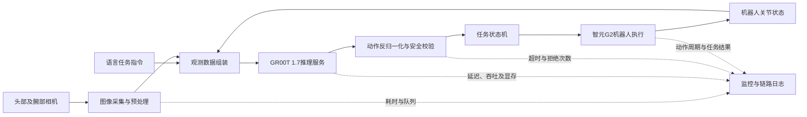
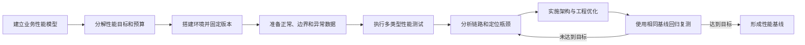

# 论系统性能测试技术及其应用

## 摘要

2026年，我所在企业为推动人工智能技术在工业生产中的落地，启动了机器人推理自动化概念验证项目。我作为部门经理和项目负责人，负责需求分析、总体架构设计、技术选型、资源协调、性能指标制定及测试改进。项目以工厂铝条上下料为场景，由智元G2机器人完成铝条的抓取与放置，采用视觉—语言—动作VLA模型根据相机图像、语言指令和机器人状态生成动作。项目先后验证了π0.5、GR00T 1.7和Linbot 2.0，最终以GR00T 1.7作为主要推理方案。为验证系统能否持续稳定运行，我组织团队从推理接口负载、并发任务调度、数据读取吞吐、长时间稳定性及极限压力等方面开展性能测试，重点监控端到端响应时间、推理吞吐量、GPU显存、CPU与内存利用率、动作周期抖动和任务成功率。针对测试中发现的双臂推理负载高、图像预处理阻塞、日志写入影响控制周期以及机械容差不足等问题，我们采用单臂推理、流水线并行、异步日志、专用夹爪、工装导向和二次精定位等措施实施优化。本文结合该项目，论述性能测试的核心类型、指标、流程以及性能测试在VLA工业机器人系统中的实践应用。

## 正文

### 一、项目概况及本人承担的主要工作

传统工业机器人主要依靠人工示教和固定程序完成重复作业，当工件位置、姿态或任务发生变化时，通常需要工程师重新调整程序。VLA模型能够同时处理视觉信息、语言任务和机器人状态，并直接生成动作序列，为机器人适应非结构化环境提供了新的技术路线。公司管理层要求在2026年完成机器人新技术的工业应用验证，因此我们选择铝条上下料作为内部POC场景：机器人从上料工位抓取较长的铝条，搬运后放入目标夹具，以验证VLA模型在真实工厂中的感知、推理与控制能力。

系统由智元G2机器人、头部及腕部相机、末端夹爪、工装夹具、边缘计算节点、VLA推理服务、任务状态机、数据采集服务和监控平台组成。采集端记录相机视频、任务指令、关节角、末端位姿、夹爪状态和人工遥操作动作；训练端完成数据清洗、样本构建和模型训练；推理端接收实时观测并输出动作；控制端负责动作限幅、安全校验、状态转换和异常停止。

项目的核心运行链路如图1所示。性能测试不仅关注模型本身，还需要覆盖从视觉采集到机器人执行的完整闭环。

**图1　VLA机器人系统及性能观测链路**

我作为部门经理和项目负责人，主要承担以下工作：一是组织工艺、机械、电气、机器人和算法人员分析业务流程，确定POC边界及性能目标；二是主持总体架构设计，明确数据采集、训练、推理、控制和监控模块之间的接口；三是组织π0.5、GR00T 1.7与Linbot 2.0的技术验证，并协调复旦大学博士专家指导团队打通π0.5的数据采集、训练和推理流程；四是制定分层性能测试方案，协调软件仿真、数据回放和真机验证；五是主持性能问题分析，决定将双臂方案调整为单臂方案，并推动夹爪、工装和软件流水线的联合优化。

我将项目分为流程打通、单动作验证、连续任务验证和现场适配四个阶段。考虑到真机压力测试可能造成设备碰撞和工件损坏，我要求绝大部分高负载测试先在离线数据回放与仿真环境完成，达到退出条件后再进行受控的硬件在环和真机测试。

### 二、性能测试的核心类型、关键指标及测试流程

性能测试不是简单测量一次运行速度，而是在特定软硬件环境和业务负载下，验证系统的响应能力、处理能力、资源消耗及稳定性，并定位限制系统扩展和持续运行的瓶颈。结合本项目，我将性能测试划分为负载测试、压力测试、并发测试、容量测试和稳定性测试五类。

| 测试类型 | 主要目的 | 本项目测试方式 | 重点观察内容 |
|---|---|---|---|
| 负载测试 | 验证预期负载下能否达标 | 按实际控制节拍回放图像和状态 | P95延迟、推理节拍、资源余量 |
| 压力测试 | 找到性能拐点和系统极限 | 逐步提高帧率、分辨率和请求量 | P99延迟、队列、显存不足、超时 |
| 并发测试 | 验证资源竞争和调度能力 | 模拟多个逻辑机器人会话 | 会话公平性、吞吐量、限流效果 |
| 容量测试 | 验证大规模数据处理能力 | 扩大episode、视频和日志规模 | 扫描速度、训练抽样、存储吞吐 |
| 稳定性测试 | 发现长期运行问题 | 长时间循环回放并定期切换任务 | 内存泄漏、显存碎片、延迟漂移 |

**表1　本项目性能测试类型及应用方式**

负载测试是在预期业务负载下验证系统是否达到性能目标。本项目通过回放正常采集的相机帧、机器人状态和任务指令，按照实际控制频率调用推理接口，测量端到端延迟、吞吐量与资源利用率。压力测试逐步增加输入频率、图像分辨率、并行推理任务数和日志量，直到系统出现超时、显存不足或请求积压，从而确定性能拐点和安全容量。并发测试模拟多台机器人或多个测试任务同时调用推理服务，检查GPU调度、模型实例、请求队列和数据服务之间的竞争。容量测试用于验证数据规模增长后，训练数据扫描、样本抽取、模型加载和日志查询是否仍能满足要求。稳定性测试则让系统在目标负载下持续运行，观察内存泄漏、显存碎片、线程阻塞、连接泄漏和延迟漂移。

我组织团队建立了四级指标体系。第一类是时间指标，包括图像采集延迟、预处理耗时、模型推理耗时、后处理耗时、动作下发耗时和端到端响应时间，并同时统计平均值、P95、P99和最大值，避免平均值掩盖偶发长尾。第二类是吞吐指标，包括每秒推理次数、每秒处理帧数、单位时间完成的动作片段数以及连续任务完成数量。第三类是资源指标，包括CPU、内存、GPU利用率、显存、磁盘读写和网络带宽。第四类是业务指标，包括抓取成功率、放置成功率、完整任务成功率、超时率、异常恢复次数和动作周期抖动。对于机器人系统，仅提高推理吞吐而导致动作不连续或成功率下降，不能视为性能提升。

| 指标层次 | 典型指标 | 指标作用 |
|---|---|---|
| 时间指标 | 采集、预处理、推理、后处理及端到端延迟 | 判断闭环响应能否满足控制节拍 |
| 吞吐指标 | 每秒推理次数、每秒处理帧数、任务完成数 | 判断单位时间处理能力 |
| 资源指标 | CPU、内存、GPU、显存、磁盘和网络 | 发现资源饱和及扩容需求 |
| 业务指标 | 抓取/放置成功率、超时率、动作抖动 | 判断性能优化是否真正改善业务 |

**表2　VLA系统四级性能指标体系**

性能测试流程分为六步。首先，根据铝条上下料业务链路建立性能模型，明确图像频率、状态数据量、推理周期、任务峰值和可接受延迟。其次，将端到端目标分解至采集、预处理、推理、控制和存储各环节，形成可测量的性能预算。第三，搭建与现场相近的软硬件环境，固定模型版本、推理精度、图像分辨率、GPU驱动和机器人控制参数。第四，准备正常、边界和异常三类数据集，通过数据回放生成可重复负载。第五，执行基准、负载、压力、并发及稳定性测试，使用统一时钟和关联ID记录全链路数据。第六，根据监控和跟踪结果定位瓶颈，完成优化后用相同数据和脚本回归验证，形成“测试—分析—优化—复测”的闭环。

**图2　性能测试与优化闭环**

### 三、性能测试方案设计与实施

#### 1. 建立分层测试架构

VLA系统同时涉及模型、软件、GPU、网络和机器人机械执行，若只测最终任务耗时，很难判断瓶颈位于哪个环节。因此，我将性能测试划分为组件级、服务级、链路级和业务级四层。

组件级测试分别测量视频解码、图像缩放与归一化、状态拼接、模型前向推理、动作反归一化和日志写入耗时。服务级测试绕过真机，以历史观测数据持续请求推理服务，验证单实例和多实例的吞吐、队列长度及资源消耗。链路级测试引入相机、状态采集、网络通信、推理和机器人控制适配器，测量从“观测产生”到“动作到达控制器”的端到端延迟。业务级测试在安全区域内执行完整的接近、抓取、抬升、搬运、粗放置和精定位流程，记录完整任务时间、成功率和异常恢复效果。

该分层方法使团队能够把“机器人动作慢”分解为可量化的问题。例如，若模型推理耗时稳定而端到端延迟明显增大，就应检查图像队列、网络传输或同步等待，而不是直接更换模型。

#### 2. 设计负载、并发和压力场景

基准测试采用固定的模型权重、单路任务和代表性数据集，连续执行多轮预热后再采样，避免首次模型加载和GPU内核初始化影响结果。负载测试按照真实控制节拍持续输入相机图像和机器人状态，观察正常负载下P95延迟、动作周期与资源余量。

并发测试不让多台真实机器人同时进行危险动作，而是在推理节点上创建多个逻辑机器人会话，分别回放独立episode。测试从单会话逐步增加并发量，观察推理队列、GPU利用率、显存和各会话的延迟公平性。当资源接近上限时，再验证限流、排队、超时和降级策略是否有效。

压力测试采用阶梯加压方式，逐步提升图像输入频率、分辨率和并发会话数，直到P99延迟超过性能预算或资源耗尽。系统达到阈值后不继续盲目加压，而是记录拐点，并验证是否能够拒绝新任务、完成在途动作和恢复到稳定状态。容量测试则扩大episode和视频数据量，测量数据扫描、训练抽样和统计计算速度，防止数据平台成为训练阶段的新瓶颈。

稳定性测试使用历史数据进行长时间循环回放，同时定期切换任务和重载模型，检查内存、显存、文件句柄和线程数量是否持续增长。真机稳定性测试的负载低于离线极限，并设置速度限制、工作空间限制、急停人员和自动超时，确保测试不会突破设备安全边界。

#### 3. 建立可观测性与结果判定机制

我要求每次请求携带统一的任务ID、episode编号和帧号，并在图像采集、预处理开始、推理开始、推理结束、动作校验及动作发送等节点记录单调时钟时间戳。监控平台展示CPU、内存、GPU利用率、显存、队列长度、请求速率、错误率和延迟分位数，运行日志记录模型版本、数据版本和机器人配置。

测试结果不能只看某个最快值，而应同时满足三类条件：一是P95和P99响应时间符合控制节拍要求；二是在持续运行中没有无法回收的资源增长；三是抓取、搬运和放置的业务成功率没有因优化而下降。对于少量长尾请求，系统应由任务状态机执行保持、减速或安全停止，不能把过期动作继续发送给机器人。

### 四、关键挑战、瓶颈定位及应对措施

#### 1. 双臂推理计算量和控制复杂度过高

项目初期考虑到铝条较长，计划使用双臂协同抓取。测试发现，双臂方案不仅输出动作维度更高，而且两臂需要在相同时间窗口内协调位置、姿态和夹持时机。推理负载、动作周期抖动及失败率均明显高于单臂方案；任一机械臂的小误差还会通过长铝条形成相互约束。

我组织算法、机器人和机械人员复盘后，决定在POC阶段改为单臂推理，以减少模型输出维度和协同约束。与此同时，将通用两指夹爪改造成适配铝条截面的专用夹爪，通过机械导向弥补模型定位误差。这一调整降低了推理与控制复杂度，也减少了双臂同步等待产生的长尾延迟。该实践说明，性能优化不能局限于代码和GPU，合理调整系统功能分配同样能够从根本上降低负载。

#### 2. 图像预处理与模型推理串行造成等待

链路跟踪显示，初版程序采用串行流程：采集完图像后再进行解码、缩放、归一化和模型推理，推理期间采集线程还会等待日志落盘。平均延迟看似可以接受，但部分请求出现明显长尾，机器人动作表现为短暂停顿。

对此，我指导团队将采集、预处理、推理、后处理和日志写入拆成有界流水线。采集线程只保留最新有效观测，避免旧帧无限排队；预处理使用独立工作线程并复用内存缓冲区；推理服务完成预热后再接受任务；日志通过异步队列批量写入。对于超过有效期的观测，系统直接丢弃并等待新帧，而不是对过期画面继续推理。优化后，链路中的排队等待显著减少，动作连续性得到改善。

#### 3. 高负载下显存和推理吞吐相互制约

在并发和压力测试中，增加批量能够提高GPU吞吐，但批量过大会增加单个请求的等待时间和显存占用，不适合闭环机器人控制。多个模型常驻又容易导致显存不足。为此，我们没有单纯追求GPU利用率，而是以控制延迟为优先，限制最大批量和等待窗口，对在线控制请求设置更高优先级，并将离线评估、数据分析等任务安排在独立资源或非生产时段。模型切换采用受控加载和健康检查，避免在动作执行过程中抢占显存。

经过优化，系统在正常负载下保持了稳定的推理节拍，在超过设计容量时能够排队、限流或拒绝非关键请求，而不是因显存耗尽导致整个进程异常退出。

#### 4. 软件性能合格但放置任务仍不稳定

一次测试中，推理延迟、资源利用率和动作下发周期均达到预期，但整机放置成功率仍不稳定。通过视频与轨迹回放，我们确认问题并非计算性能不足，而是视觉误差、机器人重复定位误差、夹爪姿态误差和工装制造误差在末端叠加。若继续通过增加训练数据和模型规模解决，不仅成本较高，还可能增加推理延迟。

我组织团队改造工装夹具，增加导向面和机械限位，扩大粗放置阶段的容差；同时把一次精确放置拆分为粗定位和二次精定位两个动作。这样，VLA模型负责把铝条送入较大的可接受区域，机械结构完成被动纠偏，确定性程序再执行二次精定位。改造后任务运行更加稳定，也说明性能指标必须与业务成功率联合分析，否则容易把机械问题误判为模型或算力问题。

#### 5. 团队缺少统一的性能基线

项目早期，不同成员使用不同数据、参数和统计口径进行测试，结果无法横向比较。为解决该问题，我要求建立固定基准数据集和测试清单，统一模型权重、硬件配置、图像分辨率、推理参数、预热次数和统计区间。每次优化均保存原始监控数据、测试脚本、版本信息和结论，并以同一基线执行回归。

通过统一基线，我们能够区分模型变化、软件优化和机械改造分别带来的影响，也避免了只挑选成功案例或最快结果进行评价的问题。

### 五、测试效果与经验总结

通过分层性能测试和多轮优化，项目完成了从数据采集、模型训练、边缘推理、动作控制到运行监控的闭环验证。系统能够在目标工作负载下保持较稳定的推理和控制节拍；图像流水线和异步日志降低了长尾等待；单臂方案减少了推理与控制复杂度；专用夹爪、导向工装和二次精定位提高了完整任务的稳定性。压力测试还帮助团队明确了当前推理节点的安全容量，并验证了超载情况下的限流、超时和安全停止机制。

| 测试发现 | 定位依据 | 优化措施 | 改进效果 |
|---|---|---|---|
| 双臂动作抖动、失败较多 | 输出维度高且双臂同步等待明显 | 改用单臂并配置专用夹爪 | 降低推理和协同控制复杂度 |
| 端到端延迟存在长尾 | 预处理、推理和日志串行阻塞 | 有界流水线、缓冲复用、异步日志 | 减少排队和过期观测 |
| 高并发时显存压力较大 | 批量和模型实例竞争GPU资源 | 限制批量、请求分级和受控加载 | 超载时能够限流而非整体退出 |
| 软件指标达标但放置不稳定 | 视频回放显示多类误差在末端叠加 | 导向工装、粗定位与二次精定位 | 提高完整任务稳定性 |

**表3　主要性能问题、优化措施及效果**

本项目使我形成了三点认识。第一，性能测试应从业务目标出发。对VLA机器人而言，端到端延迟、动作抖动和任务成功率比单一的模型每秒推理次数更重要。第二，必须建立组件、服务、链路和业务四级性能视图，只有将监控数据与任务轨迹关联，才能准确定位瓶颈。第三，性能优化是体系化工作，应在模型、软件、硬件和机械结构之间进行权衡；通过降低任务复杂度和增加机械容差，有时比单纯升级GPU或扩大模型更有效。

## 结语

本项目仍处于工厂内部POC阶段，距离长期无人值守生产还需要完善异常场景数据、故障注入、模型量化、安全认证和多机器人资源调度。但实践证明，系统化的性能测试能够在上线前暴露响应延迟、资源竞争、稳定性和业务成功率方面的问题，并为架构优化提供可量化依据。作为项目负责人，我将继续推动性能基线自动化、测试数据版本化和持续性能回归，使VLA机器人系统从“能够运行”逐步发展到“稳定、可控并可复制地运行”。
