# Python Design Patterns

These are small, runnable examples of the 23 classic Gang of Four (GoF) design patterns.
They are intentionally simple so you can focus on the idea rather than framework code.

## Categories

- `creational/` — ways to create objects
- `structural/` — ways to combine objects and classes
- `behavioral/` — ways for objects to communicate and share responsibilities

Run any example from the project root:

```bash
python patterns/creational/factory_method.py
```

The examples use only Python's standard library. Read the source comments, change the
inputs in `main()`, and run the file again to experiment.

## Pattern index

### Creational

1. Singleton — one shared instance
2. Factory Method — subclasses choose the product
3. Abstract Factory — families of related products
4. Builder — construct a complex object step by step
5. Prototype — copy an existing object

### Structural

6. Adapter — convert one interface into another
7. Bridge — separate abstraction from implementation
8. Composite — treat objects and groups uniformly
9. Decorator — add behavior without changing the original class
10. Facade — provide a simple interface to a complex subsystem
11. Flyweight — share common object data
12. Proxy — stand in for and control access to another object

### Behavioral

13. Chain of Responsibility — pass a request through handlers
14. Command — turn a request into an object
15. Interpreter — evaluate a small language or grammar
16. Iterator — traverse a collection without exposing its internals
17. Mediator — centralize communication
18. Memento — save and restore state
19. Observer — notify subscribers about changes
20. State — change behavior when state changes
21. Strategy — swap an algorithm at runtime
22. Template Method — define algorithm steps, customize selected steps
23. Visitor — add operations without changing element classes

## Mermaid diagrams

The diagrams below show the main relationship in each pattern. In Mermaid, an arrow
means “uses”, “creates”, or “implements”, depending on the pattern.

### Creational patterns

#### 1. Singleton

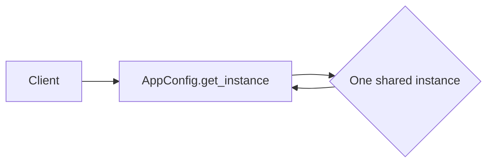

#### 2. Factory Method

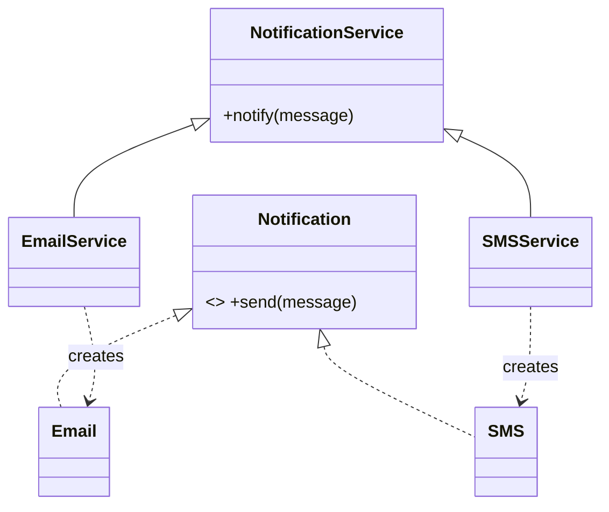

#### 3. Abstract Factory

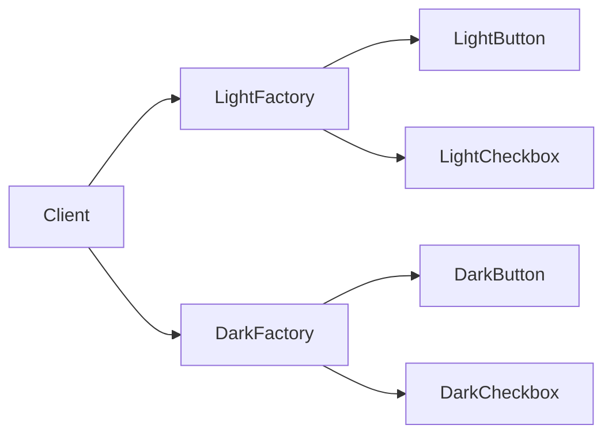

#### 4. Builder

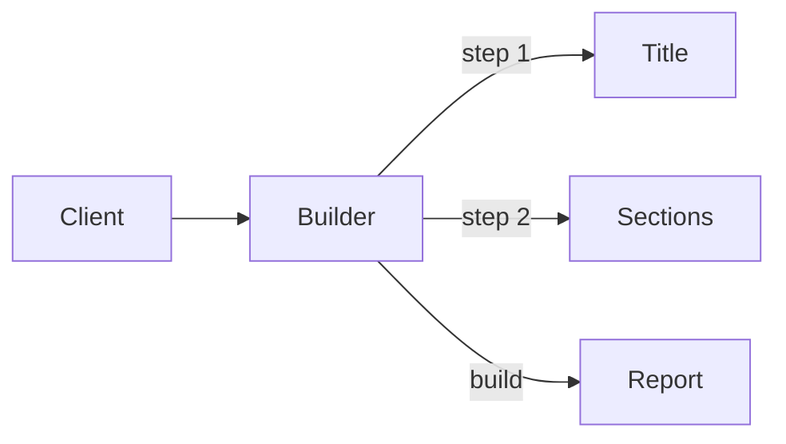

#### 5. Prototype

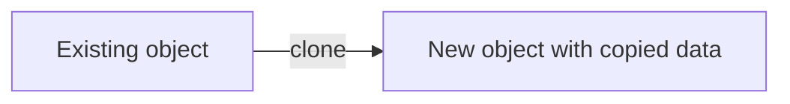

### Structural patterns

#### 6. Adapter

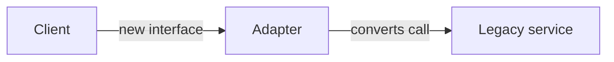

#### 7. Bridge

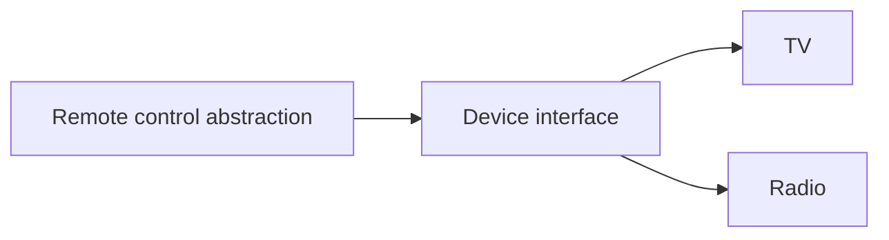

#### 8. Composite

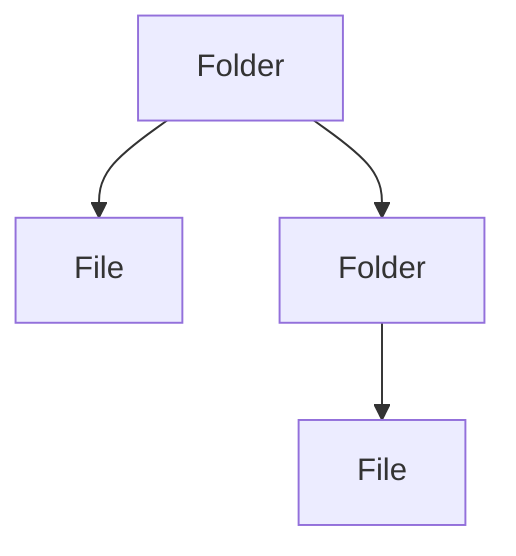

#### 9. Decorator

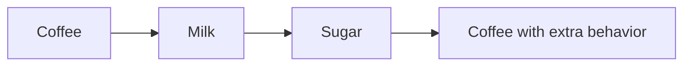

#### 10. Facade

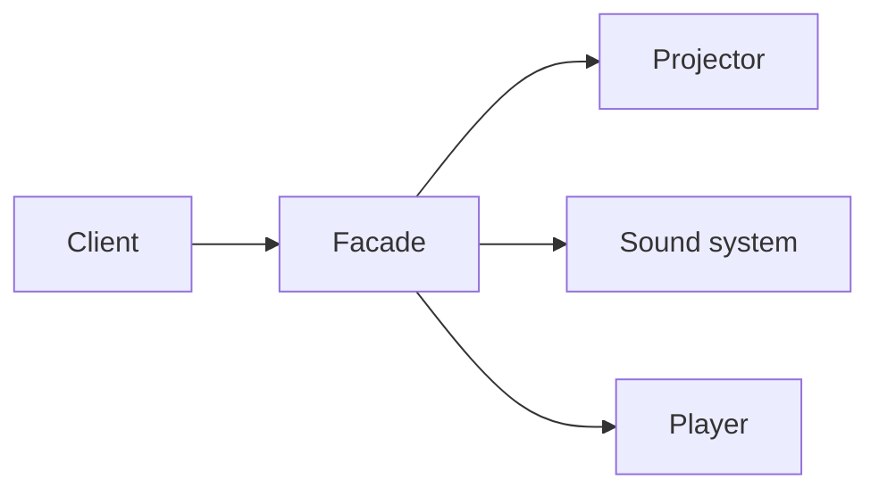

#### 11. Flyweight

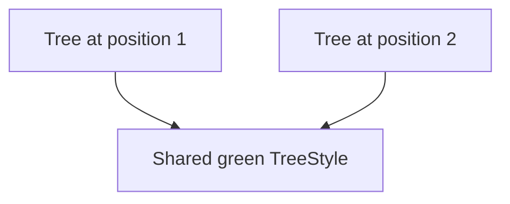

#### 12. Proxy

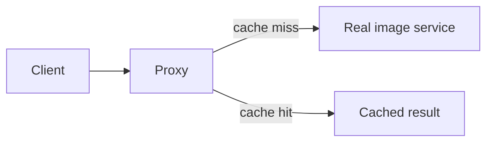

### Behavioral patterns

#### 13. Chain of Responsibility

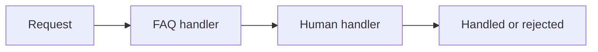

#### 14. Command

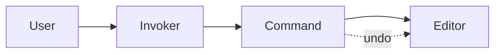

#### 15. Interpreter

```mermaid
flowchart TD
    Expression[2 + 3] --> Add
    Add --> Number2[2]
    Add --> Number3[3]
    Add --> Result[interpret() = 5]
```

#### 16. Iterator

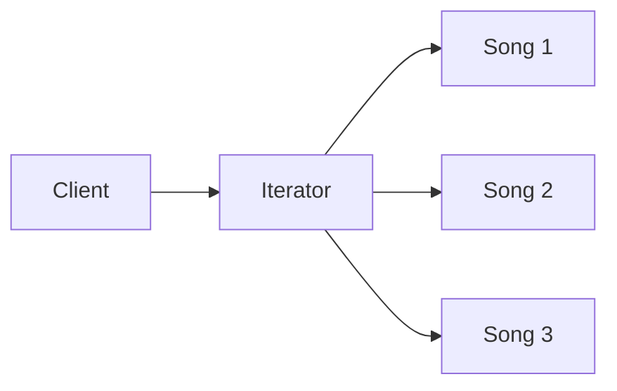

#### 17. Mediator

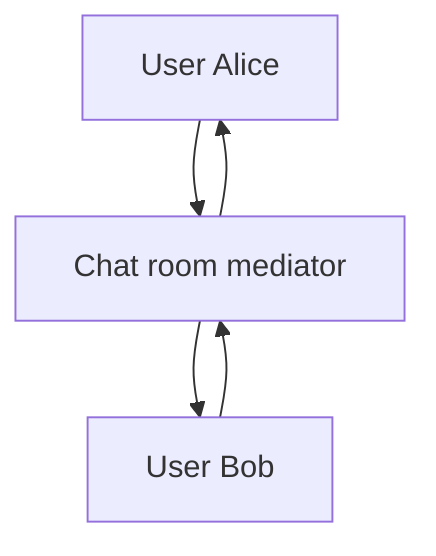

#### 18. Memento

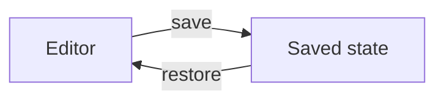

#### 19. Observer

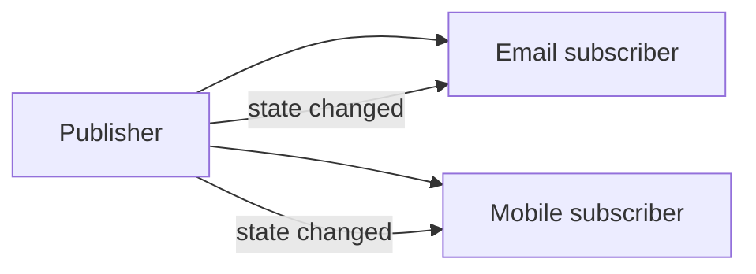

#### 20. State

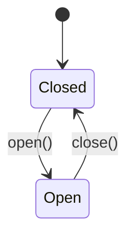

#### 21. Strategy

```mermaid
flowchart LR
    Checkout --> Strategy
    Strategy --> Regular[Regular pricing]
    Strategy --> VIP[VIP pricing]
```

#### 22. Template Method

```mermaid
flowchart TD
    Recipe[prepare()] --> Boil[boil water]
    Boil --> Brew[brew - customized]
    Brew --> Pour[pour]
    Pour --> Extras[add extras - customized]
```

#### 23. Visitor

```mermaid
flowchart LR
    Visitor[HTML exporter] --> Paragraph
    Visitor --> Image
    Document[Document elements] --> Visitor
```
