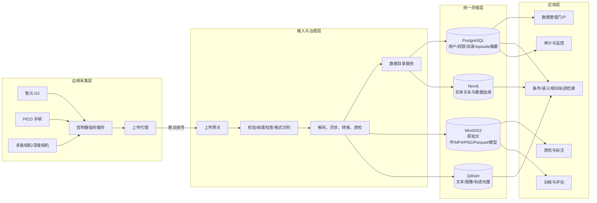
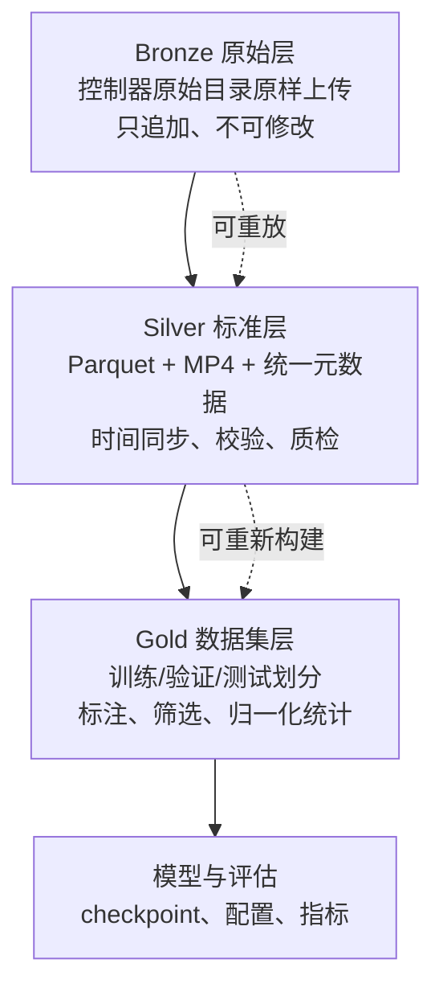
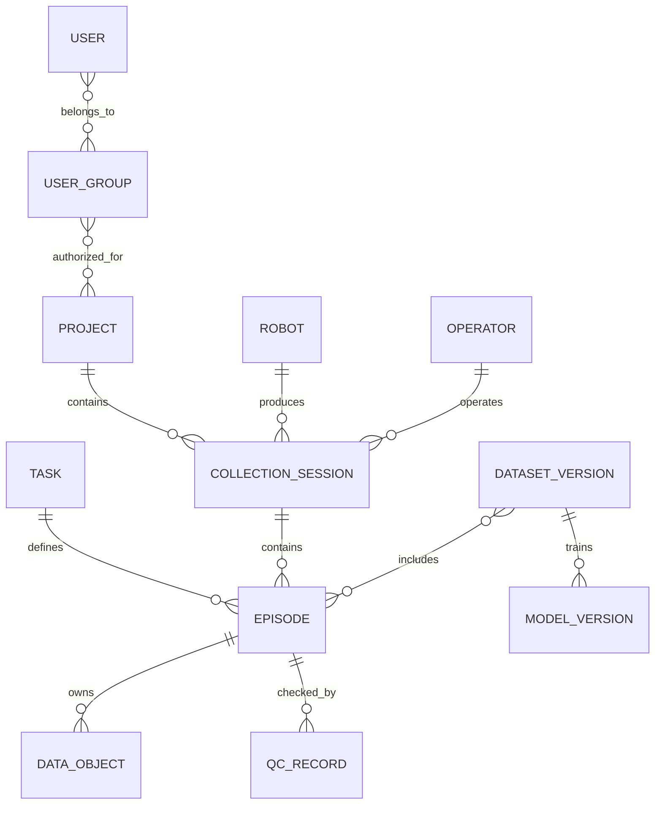
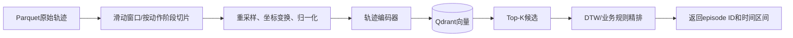
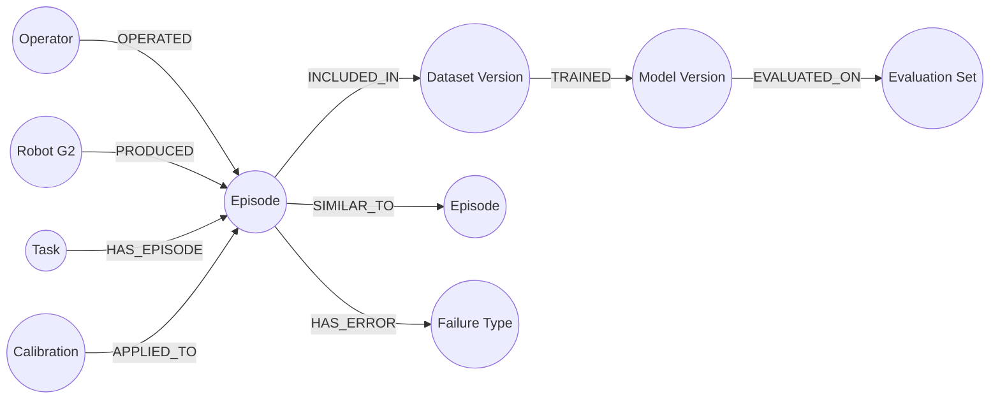
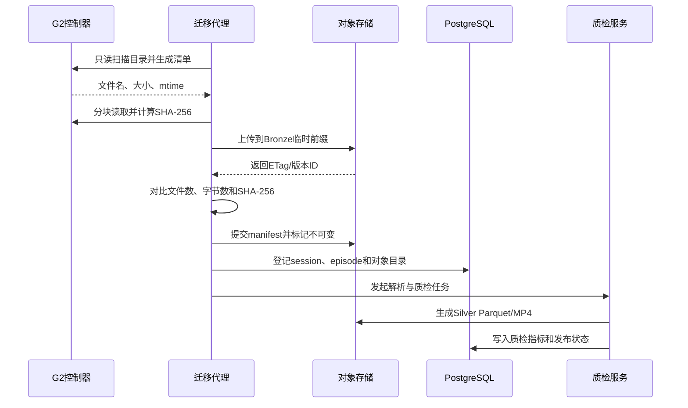
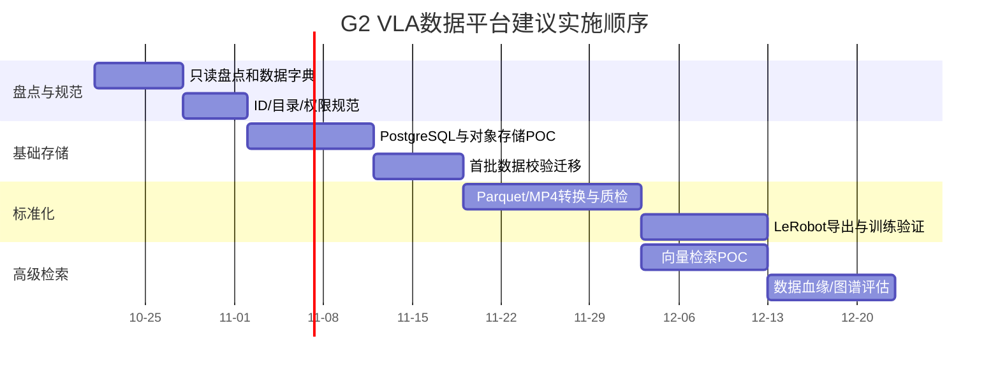

# G2 机器人 VLA 真机遥操作数据统一存储方案

> 文档状态：初步技术方案  
> 适用对象：智元 G2 机器人、PICO 手柄遥操作采集数据  
> 当前数据源：机器人控制器上的现有数据目录（主机和路径按内部资产清单管理）  
> 目标：把散落在机器人控制器上的数据建设为可管理、可检索、可追溯、可训练、可扩展的数据资产。

### 当前源数据边界

| 项目 | 当前值 |
|---|---|
| 源主机 | `10.20.15.194` |
| 只读迁移账号 | 当前为 `agi`，实施前应改为权限受限的专用账号 |
| 源目录 | `/data/agi/g2_datasets/g2_pi05_g2a0104c300179_operator_v1` |
| 采集方式 | G2真机＋PICO手柄遥操作 |
| 处理原则 | 先只读盘点和校验复制，不直接移动或删除源数据 |

明文口令不写入本方案、迁移脚本或Git仓库；现有口令应更换，并改用SSH密钥或短期凭证。

## 1. 执行摘要

本方案建议建设一个“对象存储为主体、PostgreSQL 为目录、Parquet 为训练数据格式、向量数据库和图数据库为派生索引”的 VLA 数据平台。

核心结论如下：

1. **图片、视频、深度图、原始压缩包和模型文件进入对象存储**，推荐自建 MinIO 或兼容 S3 的企业对象存储；这里应使用“对象存储”，而不是面向对象数据库。
2. **用户、用户组、项目、机器人、任务、episode、权限和审计信息进入 PostgreSQL**。
3. **关节角、末端位姿、夹爪状态、PICO 输入和时间戳的权威数据进入对象存储中的 Parquet**；PostgreSQL只保存episode级摘要和文件位置，避免逐帧关系数据撑大业务库。
4. **向量数据库只保存派生向量**，用于自然语言、图像片段和动作轨迹的相似搜索，不保存原始关节角作为唯一副本。
5. **图数据库保存数据血缘和实体关系**，如“操作员采集了哪个episode”“episode使用哪台机器人和哪版标定”“训练集由哪些episode组成”“模型由哪个数据集训练”。不建议给每一帧、每一个关节采样建立图节点。
6. 第一阶段应优先落地 PostgreSQL、MinIO 和标准化 Parquet/MP4；Qdrant 和 Neo4j 可在基础数据质量稳定后逐步引入，避免一开始堆叠过多数据库。

## 2. 当前问题与建设目标

当前数据由 PICO 手柄遥操作 G2 机器人产生，直接存放在机器人内置控制器中。这种方式适合短期采集，但不适合作为统一数据平台：

| 当前问题 | 风险 | 建设目标 |
|---|---|---|
| 数据散落在机器人控制器 | 控制器损坏会丢失数据 | 自动汇聚到中心存储并保留校验和 |
| 文件夹和文件命名不统一 | 无法稳定关联任务、episode与操作者 | 建立全局ID、目录规范和元数据目录 |
| 图片、视频、状态数据混放 | 训练加载和质量检查困难 | 按视觉、时序、元数据进行标准化 |
| 缺少权限和审计 | 无法说明谁查看、导出或删除了数据 | 统一身份、RBAC和审计日志 |
| 缺少版本和血缘 | 无法重现某个模型使用了哪些数据 | 数据集版本、标注版本和模型血缘可追溯 |
| 控制器同时承担采集和长期存储 | 占用空间并影响设备稳定性 | 控制器仅作边缘缓存，中心平台长期保存 |
| 只能按目录查找 | 无法按语义、动作或相似轨迹搜索 | 增加全文、向量和关系检索能力 |

### 2.1 非功能目标

建议在实施前由项目组确认以下指标：

| 属性 | 建议目标 |
|---|---|
| 完整性 | 每个上传对象具有 SHA-256；清单、对象数和总字节数一致 |
| 可用性 | 元数据服务和热数据存储按业务要求设置冗余 |
| 可恢复性 | 元数据每日备份；对象存储启用版本化，并保留异地副本 |
| 安全性 | 最小权限、传输加密、静态加密、审计和短期下载链接 |
| 可追溯性 | 任一模型可以追溯到数据集版本、episode和原始对象 |
| 兼容性 | 可导出 LeRobot 格式，并保留当前 π0.5/G2 原始格式 |
| 扩展性 | 增加机器人、相机和任务时，不修改已有原始数据 |

## 3. 行业方案调研

### 3.1 光轮智能 Lightwheel

用户提到的公司应为**光轮智能（Lightwheel）**。其公开平台覆盖真实/仿真数据采集、遥操作、多模态传感同步、数据生成、模型训练和评估。官方资料强调：采集数据包含同步传感流、硬件时间戳、相机内外参和轨迹，可交付为 RLDS、LeRobot 等训练格式；其 EgoSuite 还提供统一的数据管理与后处理平台。

对本项目的借鉴：

- 采集端必须输出统一时间基准；
- 原始数据与训练派生数据分层保存；
- 相机标定、机器人构型和采集设备版本属于数据的一部分；
- 数据管理应覆盖采集、质检、标注、导出、训练和评估闭环。

### 3.2 智元 AgiBot World

智元公开的 AgiBot World 采用任务和 episode 组织机器人数据。公开仓库显示，数据包含多视角视频、深度数据、机器人本体状态、动作和语言任务描述，并提供向 LeRobot 格式转换和可视化工具。其公开数据规模已经达到数十TB级，说明单机文件夹方式无法支持规模化训练。

公开的 AgiBot/LeRobot 风格结构具有以下特点：

- 低维高频信号，如关节状态、动作和时间戳，存为 Parquet；
- 相机帧编码为 MP4，并按相机通道组织；
- `info`、`tasks`、`episodes` 和统计文件描述数据模式与episode边界；
- 通过 `episode_index`、`frame_index` 和时间戳同步视觉与动作数据。

### 3.3 LeRobot Dataset

LeRobot 是值得优先兼容的开放格式。其当前公开设计将数据分为三部分：

| 组成 | 推荐格式 | 内容 |
|---|---|---|
| 表格时序数据 | Apache Parquet | 状态、动作、时间戳、帧号、episode号 |
| 视觉数据 | MP4或图片 | 各相机的同步视觉观测 |
| 元数据 | JSON/Parquet | 模式、FPS、统计量、任务和episode偏移 |

LeRobot v3把多个episode聚合到较大的Parquet/MP4分片，以减少海量小文件压力，并通过元数据恢复episode级视图。本项目可以先使用“一episode一Parquet、一相机一MP4”的简单结构，规模扩大后再转换为分片结构。

## 4. 总体架构



### 4.1 为什么采用多存储组合

| 存储 | 权威数据 | 适合做什么 | 不适合做什么 |
|---|---|---|---|
| PostgreSQL | 账号、权限、项目、任务、episode目录、审计 | 事务、约束、条件查询、管理后台 | 保存海量视频和逐帧高频状态 |
| MinIO/S3 | 原始文件、MP4、PNG、Parquet、标注、模型 | 海量文件、分片上传、版本、生命周期 | SQL关联和毫秒级小记录更新 |
| Qdrant | 文本、图像、关键帧、轨迹的派生向量 | 语义检索、相似轨迹、RAG | 代替原始数据和强事务数据库 |
| Neo4j | 项目、设备、episode、数据集、模型之间的边 | 多跳关系、影响分析、数据血缘 | 保存每帧波形和大文件 |

## 5. 数据分层与格式

建议将数据分为 Bronze、Silver、Gold 三层。



### 5.1 Bronze 原始层

原始目录必须完整保留，迁移程序不得就地改名或转码：

```text
s3://vla-bronze/g2/<project>/<collection_date>/<session_id>/
├── manifest.json
├── source/
│   └── ...控制器原始目录的完整副本...
└── checksums.sha256
```

`manifest.json`至少记录：

- 数据集和session的全局ID；
- 原始主机资产ID和原始路径；
- 机器人序列号、控制器和固件版本；
- PICO设备、采集软件和配置版本；
- 操作员、任务、场景、采集开始与结束时间；
- 相机通道、分辨率、帧率和标定版本；
- 文件数、总字节数、校验算法和迁移工具版本。

### 5.2 Silver 标准层

初期推荐一条episode形成一组逻辑对象：

```text
s3://vla-silver/g2/<dataset_id>/
├── meta/
│   ├── info.json
│   ├── tasks.jsonl
│   ├── episodes.jsonl
│   └── calibration/
├── data/
│   └── episode_000001.parquet
└── videos/
    ├── observation.images.head/episode_000001.mp4
    ├── observation.images.left_wrist/episode_000001.mp4
    └── observation.images.right_wrist/episode_000001.mp4
```

episode Parquet建议包含：

| 字段 | 类型示例 | 含义 |
|---|---|---|
| `episode_id` | UUID/string | episode全局标识 |
| `frame_index` | int64 | episode内帧号 |
| `timestamp_ns` | int64 | 统一时钟的纳秒时间戳 |
| `observation.joint_position` | float32[] | 机器人关节角 |
| `observation.joint_velocity` | float32[] | 关节速度 |
| `observation.ee_pose` | float32[] | 末端位置与姿态 |
| `observation.gripper` | float32[] | 夹爪状态 |
| `teleop.pico_pose` | float32[] | PICO控制器位姿 |
| `action` | float32[] | 下发给机器人的动作 |
| `safety_state` | string/int | 安全或急停状态 |
| `task_index` | int64 | 自然语言任务编号 |

坐标必须同时记录坐标系，例如 `base_link`、`world`、`left_ee`；姿态必须明确使用四元数、旋转矩阵还是欧拉角，以及分量顺序和单位。否则同一组数值无法可靠复用。

### 5.3 Gold 数据集层

Gold层不是简单复制Silver层，而是一个带版本的训练数据清单：

```text
dataset_version: g2_pick_place_v1.2.0
source_episodes: [ep-001, ep-004, ep-009, ...]
split:
  train: 80%
  validation: 10%
  test: 10%
filters:
  qc_status: passed
  dropped_frame_ratio: < 0.01
label_version: label-v3
normalization_stats: stats.json
```

训练/验证/测试集应按场景、物体或采集批次划分，避免同一连续采集session被随机拆到训练集和测试集造成数据泄漏。

## 6. PostgreSQL 业务与元数据设计

### 6.1 核心实体



### 6.2 建议表

| 表 | 关键字段 | 用途 |
|---|---|---|
| `users` | id、username、status、idp_subject | 用户，不保存明文密码 |
| `groups` | id、name | 用户组 |
| `roles/permissions` | role、resource、action | RBAC权限 |
| `projects` | id、name、owner_group | 项目空间 |
| `robots` | id、serial_no、model、firmware | 机器人资产 |
| `devices` | id、type、serial_no、calibration_id | PICO、相机等设备 |
| `sessions` | id、project_id、robot_id、operator_id、started_at | 一次连续采集 |
| `tasks` | id、name、instruction、scene | 任务定义 |
| `episodes` | id、session_id、task_id、status、frame_count、duration | episode目录与摘要 |
| `data_objects` | id、episode_id、bucket、key、size、sha256、media_type | 对象地址和完整性信息 |
| `qc_records` | episode_id、rule、result、metrics | 质检结果 |
| `dataset_versions` | id、semantic_version、manifest_key、status | 可复现数据集版本 |
| `audit_logs` | actor、action、resource、time、result | 管理和导出审计 |

权限建议采用“用户—用户组—项目角色—资源动作”模型，并可用PostgreSQL行级安全进一步限制用户只能看到获授权项目。生产环境接入公司统一身份源，通过OIDC/SAML登录，不在业务表中保存明文密码。

## 7. 向量数据库设计

### 7.1 应该保存什么

Qdrant等向量库保存由原始数据派生的向量和检索载荷：

| Collection | 向量来源 | 典型查询 |
|---|---|---|
| `episode_text_embedding` | 任务描述、标注、故障原因 | “找出夹爪打滑的episode” |
| `keyframe_visual_embedding` | 关键帧图像编码 | 找出视觉场景相似的抓取样本 |
| `trajectory_embedding` | 归一化轨迹编码器输出 | 找出与当前失败动作相似的轨迹 |
| `clip_embedding` | 2～5秒视频片段编码 | 检索相似动作阶段 |

Payload至少包含：`episode_id`、`project_id`、`robot_model`、`task_id`、`dataset_version`、`start_frame`、`end_frame`和权限标签。向量库命中后，通过`episode_id`回到PostgreSQL校验权限，再取得对象存储中的原始内容。

### 7.2 为什么不直接把关节角放进向量库

关节角和末端位姿是一段有顺序、有采样率、有坐标系的多变量时间序列。把每帧数值直接当成向量近邻，容易出现以下问题：

- 不同episode长度不同，无法直接使用固定维度；
- 速度变化、时间错位会导致欧氏距离失真；
- 关节角接近不代表动作语义相同；
- 向量索引是近似检索，不应成为原始数据的唯一副本。

正确路线是：原始时序保存在Parquet，按窗口重采样和归一化后，由轨迹编码器生成固定维度embedding，再写入Qdrant。必要时可以用DTW等时间序列距离进行二次精排。



## 8. 图数据库设计

图数据库用于回答跨多层关系的问题：

- 某模型使用了哪些数据集和episode？
- 某批标定参数错误，影响了哪些episode、数据集和模型？
- 某操作员、某台机器人在某任务上的失败数据有哪些？
- 一个故障episode与哪些相似episode、标注和修复方案相关？

建议节点与关系：



图数据库只保存ID、少量检索属性和关系，原始视频及逐帧时序仍在对象存储。第一阶段也可以先在PostgreSQL中实现这些关系，等多跳血缘查询明显复杂后再同步到Neo4j。

## 9. 数据接入与迁移流程

### 9.1 安全原则

方案文档中出现过控制器登录口令。该口令应立即更换，并从文档、脚本和Git仓库中移除。迁移服务应使用：

- SSH密钥或短期凭证；
- 专用只读采集账号；
- 主机密钥校验；
- 密钥管理系统或受限环境变量；
- 不在命令行、日志和配置库中记录密码。

### 9.2 首次迁移



迁移步骤：

1. 冻结或标记本次迁移的数据边界，避免扫描期间文件持续变化；
2. 只读扫描源目录，统计文件数量、大小、后缀、时间范围和空文件；
3. 生成 `manifest.json` 和 `checksums.sha256`；
4. 使用支持断点续传和限速的工具上传Bronze层；
5. 在对象存储端重新校验数量、字节数和哈希；
6. 随机抽取视频、图片、Parquet/HDF5进行可读性检查；
7. PostgreSQL登记迁移批次和对象清单；
8. 转换并生成Silver层，原始数据保持不变；
9. 至少完成“中心主副本＋独立备份”后，才允许按审批流程清理控制器缓存。

禁止使用“上传成功后立即删除源文件”的单阶段脚本。删除必须是独立审批动作，并保留审计记录。

### 9.3 后续持续采集

控制器本地采用环形缓存：episode结束后先写临时目录，所有文件关闭并生成清单后，再原子重命名到`ready/`。上传代理只处理`ready/`，上传完成后写入`uploaded`状态。网络中断时保留本地数据并断点续传；剩余空间低于阈值时报警，而不是静默覆盖未上传数据。

## 10. 数据质量检查

每个episode至少执行以下自动检查：

| 类别 | 指标/规则 |
|---|---|
| 完整性 | 必需相机、state、action、任务描述和标定文件存在 |
| 时间同步 | 各流起止时间、时钟偏差、最大帧间隔 |
| 视频质量 | 可解码、帧数、FPS、分辨率、黑屏/模糊比例 |
| 状态质量 | NaN、Inf、越界、突跳、关节维数和单位 |
| 动作质量 | action与state维度匹配、控制周期合理 |
| 轨迹质量 | 时长、成功/失败、人工接管、急停和碰撞标记 |
| 标定质量 | 标定ID存在、坐标系闭合、有效期和设备匹配 |
| 隐私安全 | 人脸、屏幕、厂内敏感信息按规则脱敏 |

质检状态建议使用：`uploaded → parsing → quarantined/validated → labeled → released → deprecated`。只有`released`的数据集版本可以进入正式训练。

## 11. 容量规划

每路视频的日存储量可粗略估算为：

```text
日容量(GB) ≈ 码率(Mbit/s) × 3600 × 采集小时 ÷ 8 ÷ 1000
```

例如3路相机，每路8 Mbit/s，每天采集8小时：

```text
3 × 8 × 3600 × 8 ÷ 8 ÷ 1000 ≈ 86.4 GB/天
```

再加深度图、原始图片、Parquet、标注、版本和冗余，规划时至少乘以1.5～3的系数。实施前必须对当前目录执行只读盘点，以真实码率、采集时长、相机数量和压缩格式代替估算值。

建议生命周期：

| 层级 | 内容 | 策略 |
|---|---|---|
| 热数据 | 最近采集和正在标注的数据 | 高性能对象存储，在线访问 |
| 温数据 | 已发布训练集 | 容量型对象存储，按需读取 |
| 冷数据 | 历史原始数据和旧版本 | 低成本归档，恢复时间可较长 |
| 删除候选 | 明确无效且超过保留期的数据 | 双人审批、延迟删除、保留审计 |

## 12. 安全与权限

建议角色：

| 角色 | 权限示例 |
|---|---|
| 采集员 | 创建session、上传本人任务数据，不可发布数据集 |
| 质检员 | 查看授权项目、填写质检和标注，不可删除原始数据 |
| 算法工程师 | 使用已发布数据集训练，不直接读取未脱敏数据 |
| 数据管理员 | 管理模式、版本、生命周期和恢复 |
| 项目负责人 | 审批数据集发布和导出 |
| 审计员 | 只读查看权限和操作日志 |

安全控制包括：

- OIDC/SAML统一登录和MFA；
- PostgreSQL RBAC/行级安全；
- 对象存储bucket policy和短期预签名URL；
- TLS传输加密和服务端静态加密；
- 生产网、采集网、训练网分区，按应用授权而非整网开放；
- 所有导出、删除、权限变更和模型发布写入不可篡改审计日志；
- 备份恢复演练，而不只是“存在备份文件”。

## 13. 高可用与备份

最低建议为“3-2-1”原则：至少三份数据、两种介质、其中一份异地。对象存储的纠删码或副本解决的是节点/磁盘故障，不能替代独立备份；版本化可以应对误覆盖，但也不能替代离线或异地副本。

| 组件 | 高可用建议 | 备份建议 |
|---|---|---|
| PostgreSQL | 主从或托管高可用 | 每日全备＋WAL持续归档，定期恢复演练 |
| MinIO/S3 | 多节点纠删码 | 版本化＋跨站复制/离线副本 |
| Qdrant | 可从派生任务重建，必要时集群副本 | Snapshot＋重建脚本 |
| Neo4j | 初期可单机，成熟后按SLA集群化 | 定期备份；保留从PostgreSQL重建能力 |
| 元数据/代码 | Git版本管理 | 远端镜像和发布归档 |

建议先确定RPO和RTO。例如元数据RPO不超过15分钟、RTO不超过4小时；原始对象一旦确认上传，原则上不允许丢失。

## 14. 推荐技术栈

| 层次 | 初期建议 | 说明 |
|---|---|---|
| 统一身份 | Keycloak或公司现有IdP | OIDC、用户组、MFA |
| 业务数据库 | PostgreSQL | 权限、目录、审计、事务 |
| 对象存储 | MinIO或现有S3兼容存储 | 图片、视频、Parquet、模型 |
| 表格格式 | Apache Parquet/Arrow | 状态、动作和时间戳 |
| 标准数据集 | LeRobot兼容格式 | 便于训练、可视化和交换 |
| 向量数据库 | Qdrant | 文本、视觉和轨迹embedding |
| 图数据库 | Neo4j；也可第二阶段引入 | 关系和血缘分析 |
| 工作流 | Airflow/Argo Workflows | 转换、质检、索引和发布 |
| 可观测性 | Prometheus＋Grafana＋日志系统 | 容量、失败率、延迟和告警 |

技术选型不是一次性结论。若团队规模较小，第一阶段可将图关系保存在PostgreSQL，并采用Qdrant单节点；只有实际查询和容量指标证明需要时再扩展集群。

## 15. 分阶段实施路线



### 第一阶段：盘点与止损

- 更换文档中暴露的控制器口令；
- 只读盘点当前目录，不移动、不删除；
- 确认数据格式、规模、采样率、坐标系和episode边界；
- 建立命名、ID和清单规范。

### 第二阶段：最小可用平台

- 部署PostgreSQL和MinIO；
- 实现断点上传、SHA-256校验、目录登记和基础权限；
- 保留Bronze原始层；
- 建立浏览、下载、质检状态页面。

### 第三阶段：训练标准化

- 输出Parquet＋MP4标准层；
- 对齐PICO、机器人状态、动作和相机时间；
- 建立自动质检；
- 打通LeRobot读取、可视化和至少一次训练作业。

### 第四阶段：智能检索和血缘

- 对任务文本、关键帧和轨迹生成embedding；
- 使用Qdrant完成相似episode检索；
- 在确有多跳分析需求后引入Neo4j；
- 建立数据集—训练作业—模型—评估结果的闭环。

## 16. 验收标准

| 范围 | 验收条件 |
|---|---|
| 迁移 | 源和目标文件数、字节数、SHA-256清单一致 |
| 可读性 | 抽检视频可播放，Parquet可读取，状态维度符合模式 |
| 同步 | 视频、关节、末端位姿和PICO输入在允许误差内对齐 |
| 检索 | 可按项目、机器人、任务、操作员、时间和状态查询 |
| 权限 | 未授权用户不能查看、下载或通过向量检索推断数据 |
| 血缘 | 模型版本可以追溯到数据集版本及其episode清单 |
| 恢复 | 完成一次PostgreSQL和对象存储的恢复演练 |
| 训练 | 从Gold数据集成功启动并完成一个小规模训练/验证任务 |

## 17. 下一步需要确认的信息

在正式实施前，需要对现有数据完成以下只读调查：

1. 当前目录总容量、文件数和每日新增量；
2. 目录层级及每种文件格式；
3. episode边界如何定义，是否已有唯一ID；
4. 相机数量、分辨率、FPS、编码和时间戳来源；
5. 关节角、末端位姿、action和PICO数据的字段、单位与采样率；
6. 坐标系和相机内外参如何保存；
7. 成功、失败、人工接管、碰撞等标签是否存在；
8. π0.5训练代码当前实际读取什么格式；
9. 预计操作员、机器人、并发上传和训练节点数量；
10. 数据保留期、涉密级别、可接受RPO/RTO和预算。

这些信息明确后，才能形成容量报价、表结构DDL、对象目录规范、迁移脚本和部署拓扑的详细设计。

## 18. 参考资料

- [Lightwheel Platform：真实遥操作、同步传感与训练数据工作流](https://www.lightwheel.ai/lightwheel-platform)
- [Lightwheel EgoSuite：统一数据管理和后处理平台](https://lightwheel.ai/egosuite)
- [AgiBot World：公开数据集、模型与转换工具](https://github.com/OpenDriveLab/AgiBot-World)
- [AgiBot World公开数据格式说明](https://huggingface.co/datasets/agibot-world/AgiBotWorld2026)
- [LeRobot Dataset v3：Parquet、MP4和元数据设计](https://github.com/huggingface/lerobot/blob/main/docs/source/lerobot-dataset-v3.mdx)
- [LeRobot项目：标准化机器人学习数据格式](https://github.com/huggingface/lerobot)
- [PostgreSQL官方文档：行级安全策略](https://www.postgresql.org/docs/current/ddl-rowsecurity.html)

> 说明：各公司的内部数据库拓扑通常并未公开。本文只依据其公开数据格式、产品能力和官方项目资料进行归纳，不把推断描述为其内部实际实现。
